# Overview of OPD View and Patient View page

_Fri, 30 Aug, 2024_ · [OPD - Out Patient (9)](https://smart-hospital.in/category/opd-out-patient) · vendor article: https://smart-hospital.in/article/overview-of-opd-view-and-patient-view-page

### Overview of OPD View and Patient View page

Fri, 30 Aug, 2024

[Articles](https://smart-hospital.in/articles)[OPD - Out Patient](https://smart-hospital.in/category/opd-out-patient)

---

To view the **OPD View** page, go to the **OPD - Out Patient** and OPD View page will open, now in this page you can see patient related multiple detials column as patient **OPD No, Patient Name, Case ID, Appointmennt Date, Consultant, Reference, Sysmptoms, Is Antenatal** and you can also create the custom field according to your requirement, here we have created **Patient Old Health Details** and **Test Details**  
  
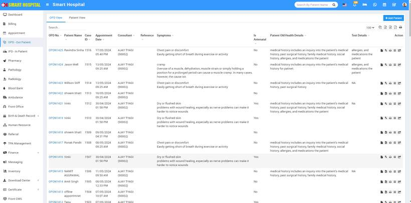  
  
  
In Action Column, here you will see the multiple option such as **Print Bill, Add Prescription, Manual Prescription, Show** (show option open the **Visit Details**) and **Move In IPD  
  
Print Bill**  
In **Action column** when you click on first option which is **Print Bill**  
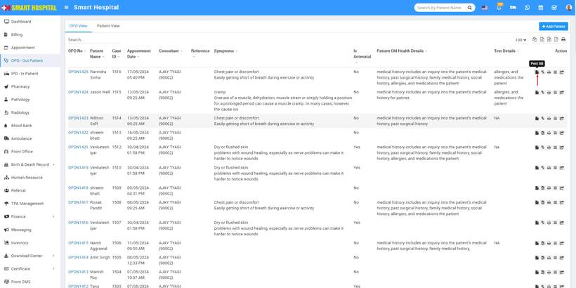  
  
**OPD Bill** will be open in print format and in this bill, you can see the patient related all details along with bill details   
  
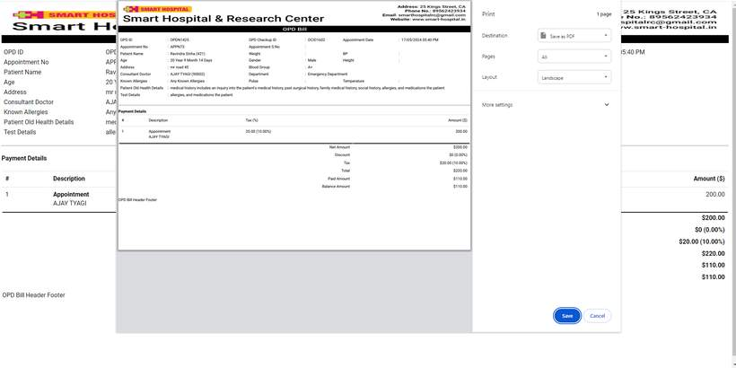  
  
**Add Prescription**In Action column, you will see the second option for **Add Prescription  
  
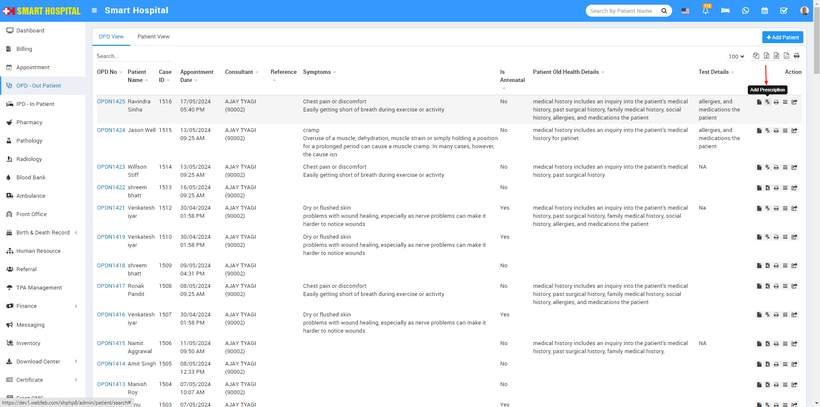**now click on **Add Prescription** option, add prescription form will be open  
  
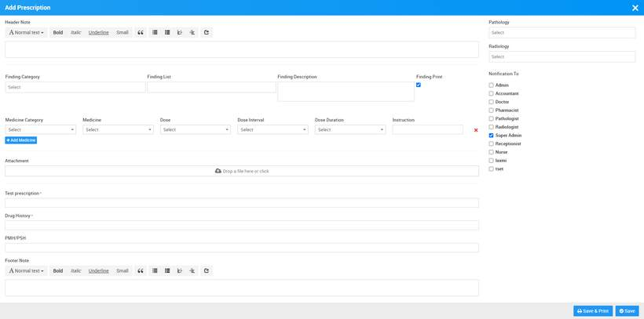  
  
  
Here in Add Prescription, you can add **Header Notes, Findings details (Symptoms finding in patient),** you can attach document using **Attachment, Medicines, Footer Note**, also in add prescription page, you can prescribed **Pathology** and **Radiology** tests to patient and send notification from **Notification** **To** option to staff members.  
  
After adding the prescription, click on '**Save**'. If you wish to view the details added to the prescription, simply click on the **Prescription** **icon**, which is currently darkened after adding the prescriptions. The OPD Prescription will open in print format. After verifying the details of the prescription, you can print it.   
  
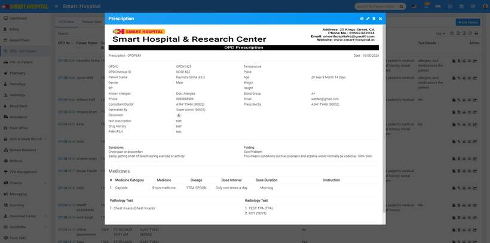  
  
Additionally, if you need to make corrections to the prescription, click on the '**Edit**' icon located at the top of the prescription and correct it.  
  
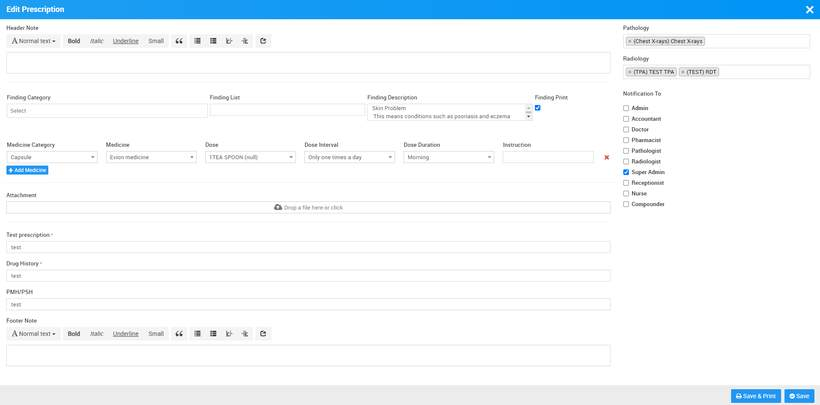  
  
  
**Manual Prescription**In Action Column, you can see **Manual Prescription** in third option, in this prescription you will see only the patient details and you can also take the print of it by click on print icon showing add the right top of the page  
  
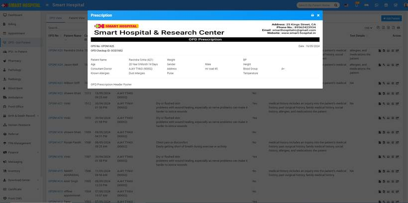  
  
**Visit Details**In **Action Column**, you can see **Show** icon in fourth option  
  
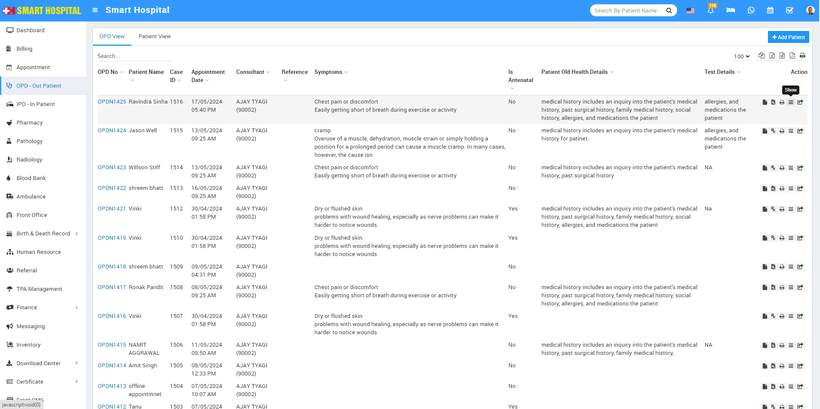  
  
When you click on **Show,** **Visit Details** the page will open, where you can view the patient's visit details. If you need to correct any details, simply click on the 'Edit' icon located at the top right of the page and edit the patient details  
  
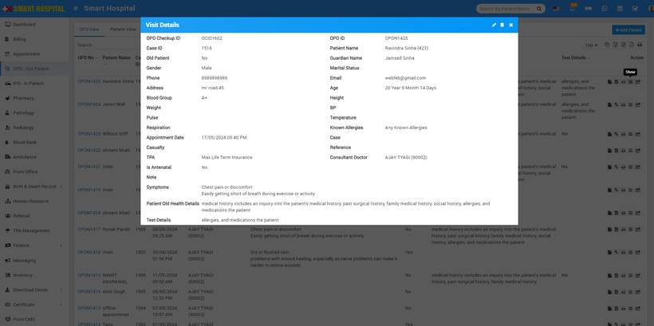  
  
  
**Move In IPD**In Action Column, you can see **Move In IPD** option which is showing in last   
  
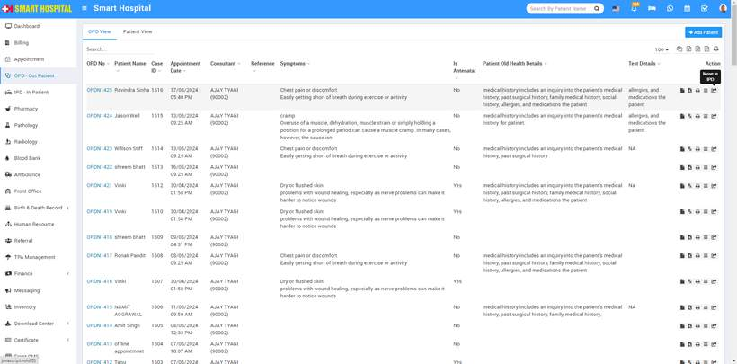  
  
After click on it, **Move Patient to IPD** page will be open, here fill the additional details of the patient such us **Symptoms Type, Symptoms Title, Symptoms Description,** **Admission Date ,Casualty, Credit Limit ($), Consultant Doctor Bed Group, Bed Number, Live Consultation**, and **Is For Antenatal** etc   
  
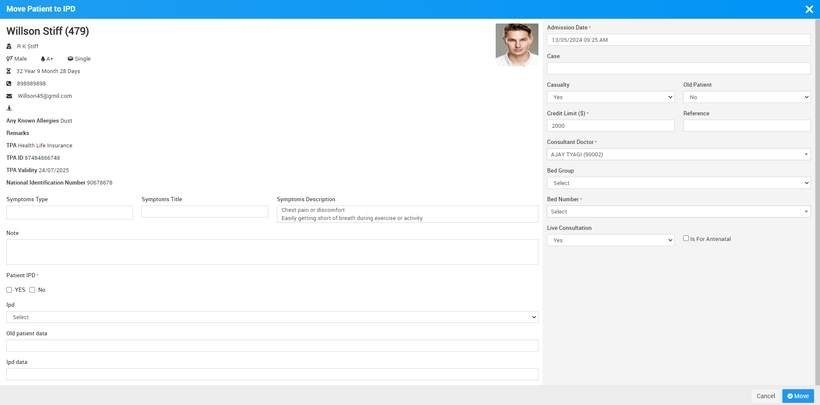  
  
After fill the all details please click on **Move** then this patient will be move from OPD to IPD successfully  
  
**Patient View page**In **OPD - Out Patient** there is two option first is **OPD View** which be already discussed in above and second is **Patient View** page which is showing next to the OPD View  
  
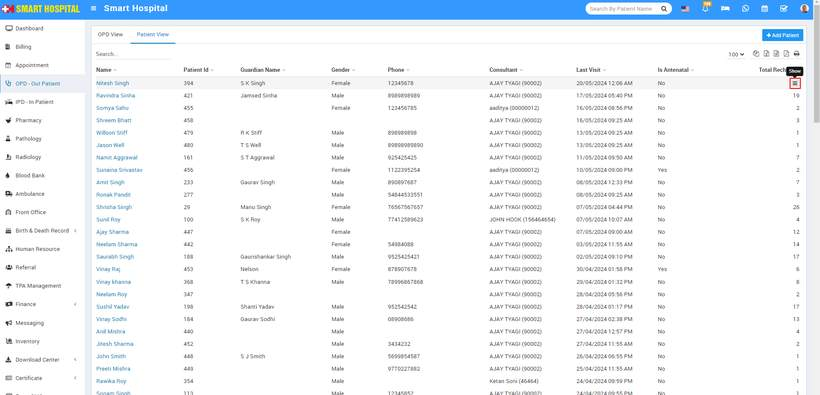  
  
  
In this page, you will see all multiple patient related details and at the last column while you hovering the mouse **Show** icon will appear and when you click on it patient overview page will be display  
  
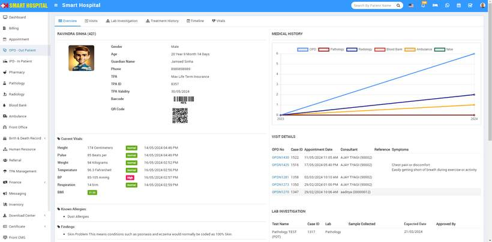  
  
****Note :**** The default tab will be the **OPD View**, showing the last created **OPD**. In the **Patient View**, the patient list will be displayed, and clicking on a patient's name will show all their       visits.
