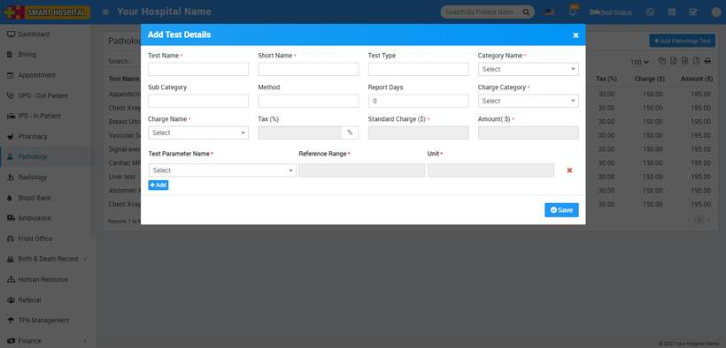

# How to add Pathology Test in Smart Hospital?

_Wed, 10 Nov, 2021_ · [Pathology (4)](https://smart-hospital.in/category/pathology) · vendor article: https://smart-hospital.in/article/how-to-add-pathology-test-in-smart-hospital

### How to add Pathology Test in Smart Hospital?

Wed, 10 Nov, 2021

[Articles](https://smart-hospital.in/articles)[Pathology](https://smart-hospital.in/category/pathology)

---

Pathology module is for managing patient pathology test and reports.

To add pathology test click on **+ Add Pathology Test** button here enter **Test Name, Short Name, Test Type, Category Name, Sub Category, Method, Report Days, Charge Category, Charge Name, Tax (%), Standard Charge, Amount**. To add Test Parameter select **Test Parameter Name**. Click on **+ Add button** and add multiple Test Parameter.  
  

Added pathology test will be list on pathology test page.
