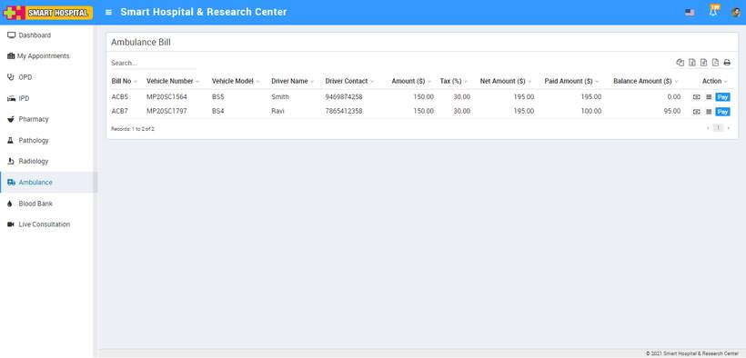
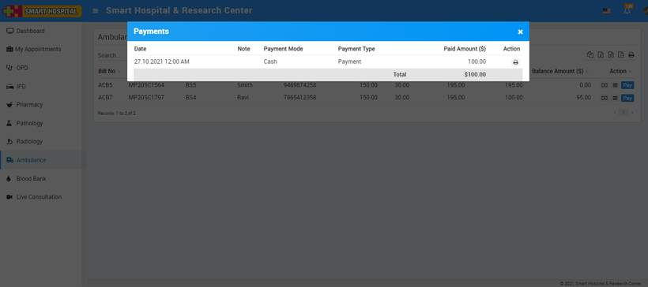
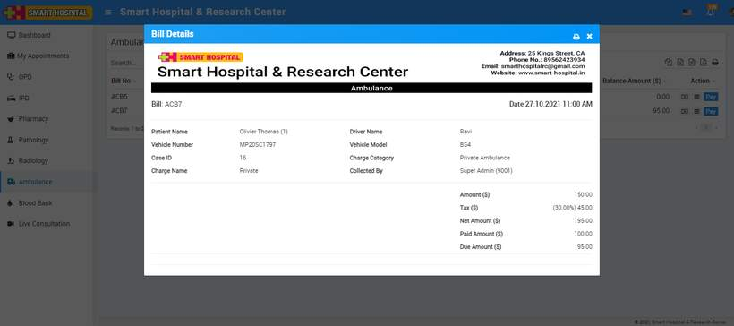
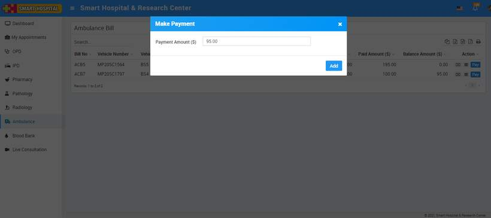
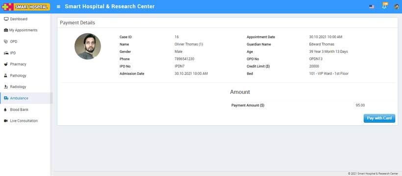

# Ambulance

_Thu, 18 Nov, 2021_ · [Patient Panel (10)](https://smart-hospital.in/category/patient-panel) · vendor article: https://smart-hospital.in/article/ambulance

### Ambulance

Thu, 18 Nov, 2021

[Articles](https://smart-hospital.in/articles)[Patient Panel](https://smart-hospital.in/category/patient-panel)

---

To check Ambulance bill details at patient panel go to **Ambulance** module, here you can check patient Ambulance bill details like **Bill No, Vehicle Number, Vehicle Model, Driver Name, Driver Contact, Amount, Tax, Net Amount, Paid Amount, Balance Amount**.  
  

To view payment details click on View Payment button available on **Action** column.  
  

To view Ambulance bill details click on Show button present at Action column. To print bill click on print button present at top right side on the header.  
  

To make online payment for Ambulance call click on **Pay** button here you can edit payment and click on add button, this will redirect you to payment gateway from where you can make online payment for Ambulance call.  
  
  
  

