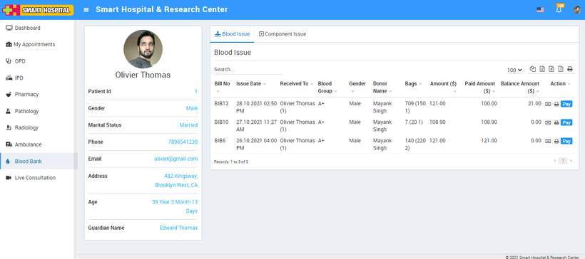
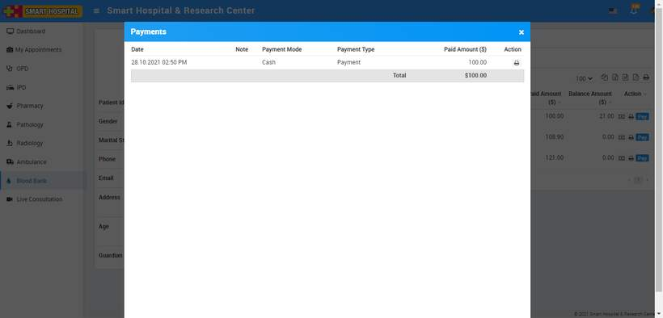
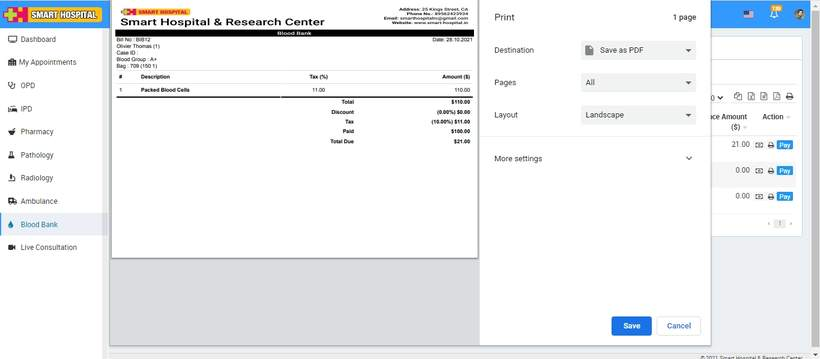
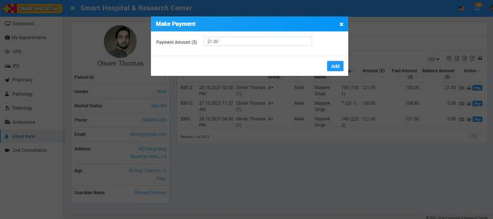
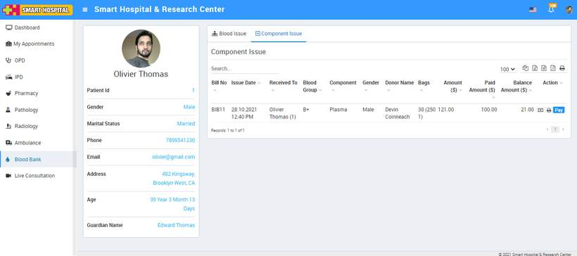
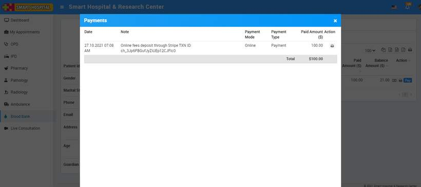
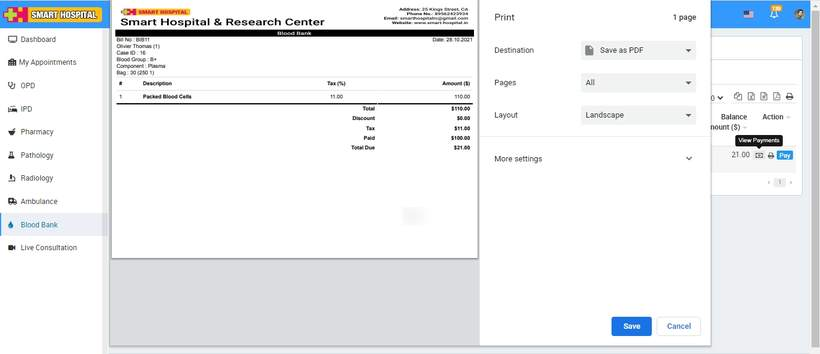
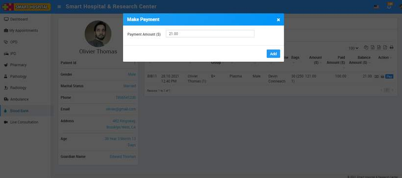

# Blood Bank

_Thu, 18 Nov, 2021_ · [Patient Panel (10)](https://smart-hospital.in/category/patient-panel) · vendor article: https://smart-hospital.in/article/blood-bank-1

### Blood Bank

Thu, 18 Nov, 2021

[Articles](https://smart-hospital.in/articles)[Patient Panel](https://smart-hospital.in/category/patient-panel)

---

To check patient Blood Bank details like Blood Issue and Component Issue Details, go to **Blood Bank**. Here you will get two section one for **Blood Issue** and another for **Component Issue**.  
  

### **Blood Issue**

To check Blood Issue details click on Blood issue tab, here you can check details like **Bill No., Issue Date, Received To, Blood Group, Gender, Donor Name, Bags, Amount, Paid Amount and Balance Amount**.  
  

To view payment details click on View **Payment** button available on Action column. To print this payment details you can print on print button icon.  
  

To print bill click on print button present at **Blood Issue List**.  
  

To make online payment for blood issue click on **Pay** button here you can edit payment and click on add button, this will redirect you to payment gateway from where you can make online payment for Patient blood issue.  
  
  
  

---

### **Component Issue**

To check Component  Issue details click on Blood issue tab, here you can check details like **Bill No., Issue Date, Received To, Blood Group, Component, Gender, Donor Name, Bags, Amount, Paid Amount and Balance Amount**.  
  

To view payment details click on View Payment button available on **Action** column. To print this payment details you can print on print button icon.  
  

To print bill click on print button present at **Component Issue List**.  
  

To make online payment for Component issue click on **Pay** button here you can edit payment and click on add button, this will redirect you to payment gateway from where you can make online payment for Patient Component issue.  
  

