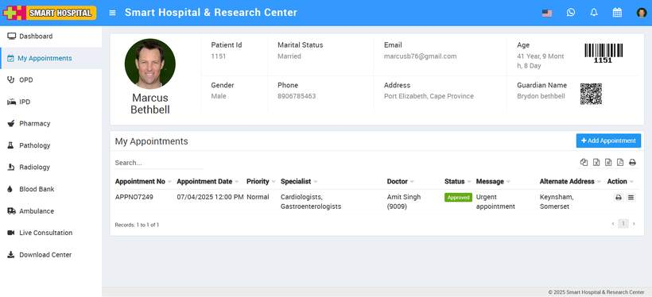
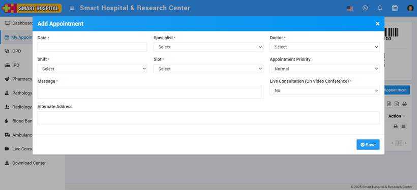
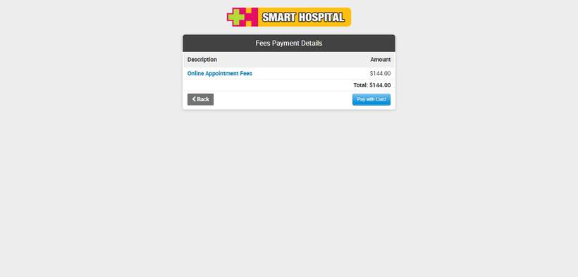

# How to add appointment from Patient panel?

_Sat, 02 Aug, 2025_ · [Patient Panel (10)](https://smart-hospital.in/category/patient-panel) · vendor article: https://smart-hospital.in/article/how-to-add-appointment-from-patient-panel

### How to add appointment from Patient panel?

Sat, 02 Aug, 2025

[Articles](https://smart-hospital.in/articles)[Patient Panel](https://smart-hospital.in/category/patient-panel)

---

To add an appointment from the patient account, go to **My Appointment**. Here you can see the patient profile along with all details.  
  

Now, click on the **+Add Appointment** button, then fill in the required details: **Date, Specialist, Doctor, Shift, Slot, Appointment Priority, Message, Live Consultation (Video Conference)**, and select a slot from the available options. Finally, click the **Save** button to complete the process.   
  
  
  
  
You can view added Appointment record at **Appointment List**. This Appointment record will how to patient as Pending until patient doesn't pay for it.  
  

To make online payment for appointment click on Pay button present at Action column.  
  
  
  
**Note**:- Here after click on Pay button page will be redirect to your selected payment method. [Click here](https://smart-hospital.in/article/payment-methods) to understand how to enable payment method.  
  
After make online payment your appointment patient will see their appointment status as **Approved**.  
  
To view appointment details click on show button icon and for delete appointment click on delete button icon present at **Action** column at Appointment list.
