# IPD

_Thu, 18 Nov, 2021_ · [Patient Panel (10)](https://smart-hospital.in/category/patient-panel) · vendor article: https://smart-hospital.in/article/ipd

### IPD

Thu, 18 Nov, 2021

[Articles](https://smart-hospital.in/articles)[Patient Panel](https://smart-hospital.in/category/patient-panel)

---

At patient account in IPD module patient can check following details like **Overview, Nurse Notes, Consultant Register, Lab Investigation, Timeline, Prescription, Charges, Payment, Treatment History, Medication, Operation Theatre, Live Consultation and Bed History.**

### **Overview-**

This section describes patients all details like patients Allergies, Findings Symptoms, Consultant Doctors, Timeline Medical History, Lab investigation, module wise payment billing details etc.  
  
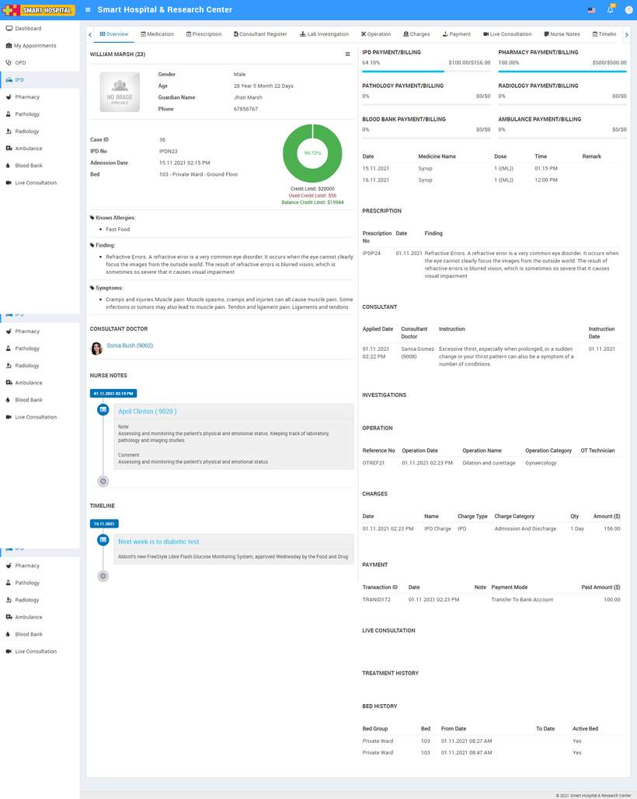  

---

### **Nurse Notes**

A nursing note is a medical note into a medical or health record made by a nurse that **can provide an accurate reflection of nursing assessments, changes in patient conditions, care provided and relevant information to support the clinical team to deliver excellent care**.

Patient can check Nurse notes from **Nurse Notes** tab.  
  
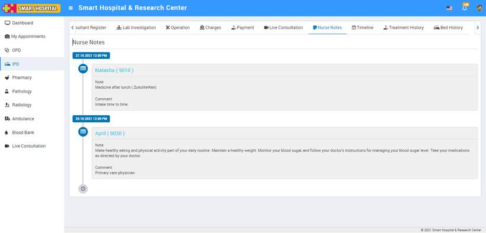

---

### **Consultant Register**

Consultant Register tab has all details about instructions given by doctors day to day for this patient's treatment. Patient can check these details from **Consultant Register** tab.  
  
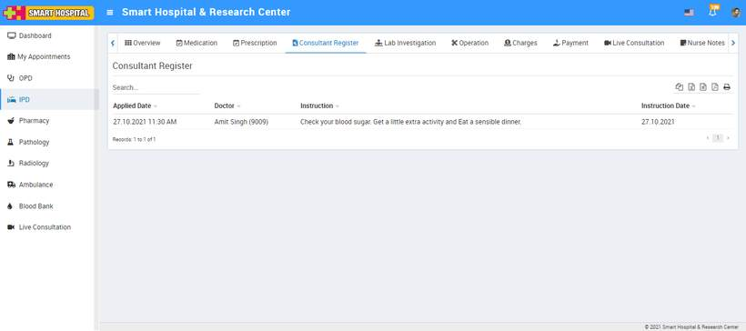

---

### **Lab Investigation**

In IPD patient can also check patient all Pathology and Radiology test under **Lab Investigation** tab.  
  
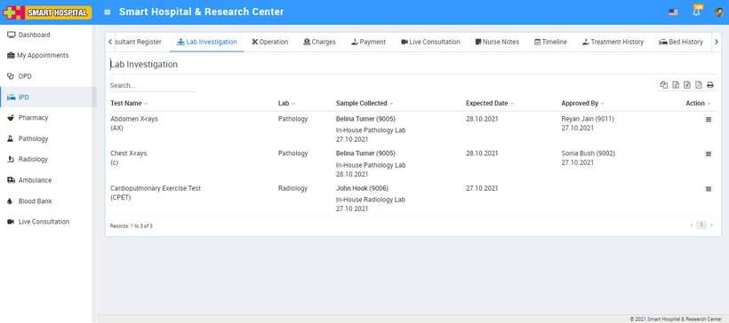

Here in Lab Investigation List you can check all listed lab reports of. You can check lab test report details from show option available at **Action** column.  
  
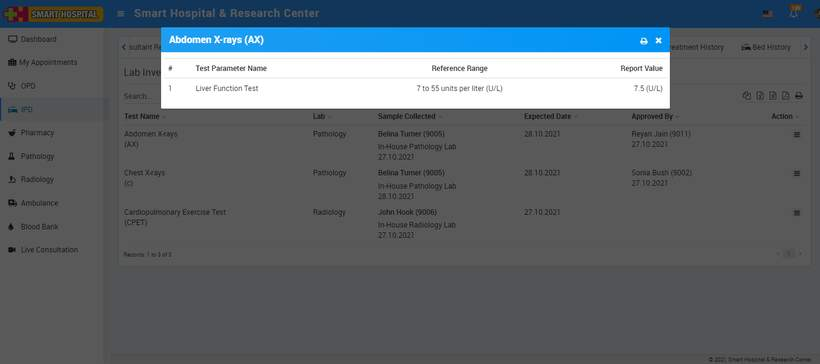

---

### **Timeline**

In Timeline section patient can see notes or quick access notes created from admin or staff panel.  
  
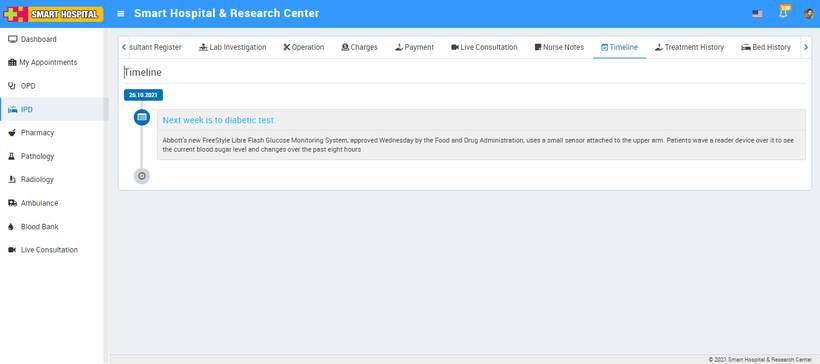

---

### **Prescription**

Here patient can check doctor’s prescribed medicines and other details at prescription tab click on **Action** button to view prescription details.  
  
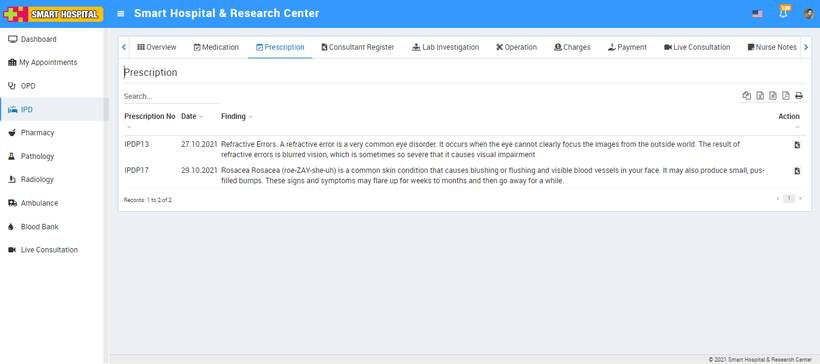

---

### **Charges**

All the added charge of patient can be check from **Charges** tab. Patient can also print charges from print button icon present at **Action** column.  
  
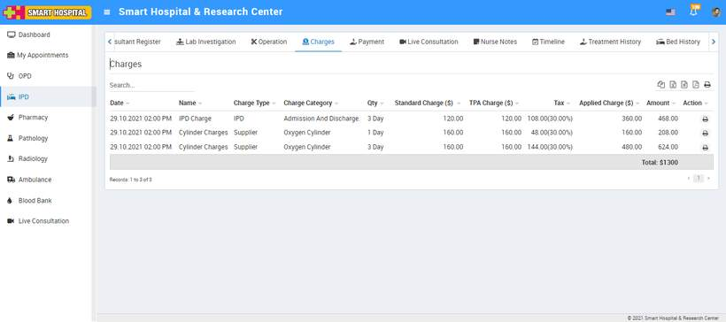

---

### **Payment**

Patient can check all the payment details done from patient side. Patient can also print Payment from print button icon present at **Action** column.  
  
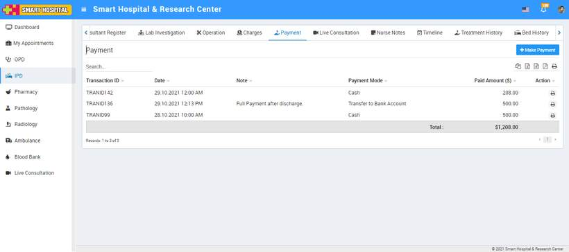

---

### **Treatment History**

At Treatment History tab under OPD patient list, you can check patients old visits and whatever treatment had been given to the patient.  
  
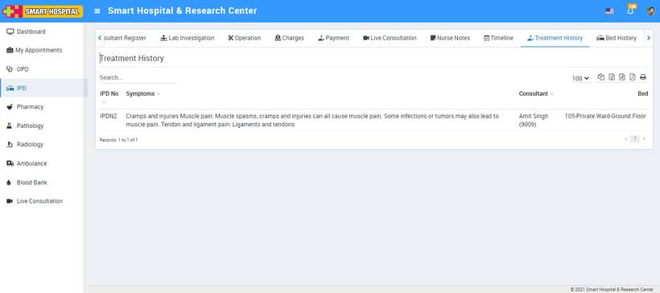

---

### **Medication**

Medication is for comparing a patient's medication orders to all of the medications that the patient has been taking.  
  
Under Medication patient can check all their medication routine which was given to the patient.  
  
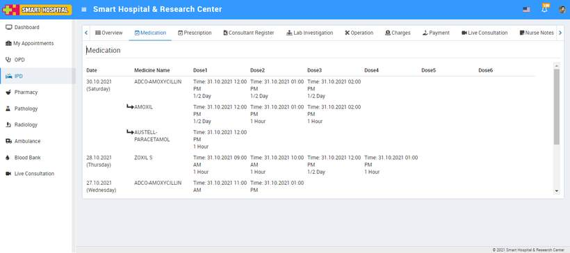

---

### **Operation Theatre**

Under Operation Theatre tab patient can check details of their all operation done under OPD.  
  
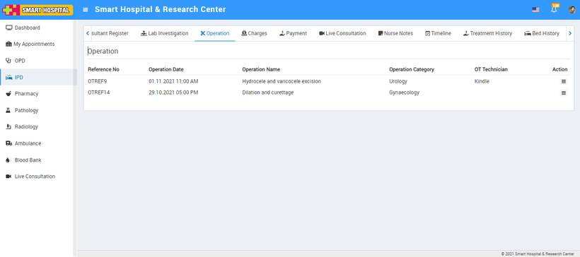  
  
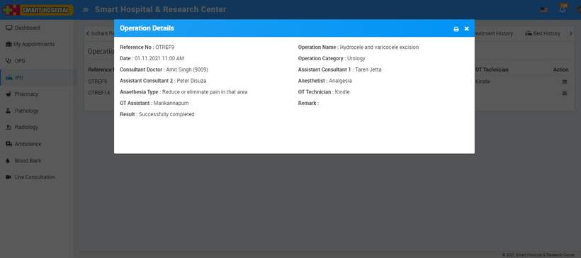

---

### **Live Consultation**

Using Live Consultation Patients can consult to doctor through zoom video call. From Live Consultation tab patient can check all their upcoming and previous Live Consultation.

---

### **Bed History**

In IPD –In Patient you will find Bed History tab, The Bed History shows the assignment of beds to the patient under different categories like Bed history when patient was admitted at ICU.

Under Bed History tab you can see **Bed Group, Bed, From Date, To Date** and current status of **Bed**.  
  
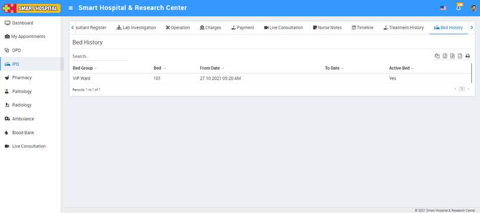
