# OPD

_Thu, 18 Nov, 2021_ · [Patient Panel (10)](https://smart-hospital.in/category/patient-panel) · vendor article: https://smart-hospital.in/article/opd

### OPD

Thu, 18 Nov, 2021

[Articles](https://smart-hospital.in/articles)[Patient Panel](https://smart-hospital.in/category/patient-panel)

---

At patient account in OPD module, there are 4 tabs available **Visits, Lab Investigations, Treatment History and Timeline**.

At Visit tab patient can find their all visits and OPD records.

To check patient details click on show button icon present at Action column.

To check treatments under particular OPD click on OPD No, here you will find multiple tabs of Overview, Visits, Charges, Payment, Lab Investigation, Timeline, Medication, Operation Theatre, Live Consultation.

### **Overview**

This section describes patients all details like patient's Allergies, Findings Symptoms, Consultant Doctors, Timeline Medical History, Lab Investigation etc. of particular visit.

**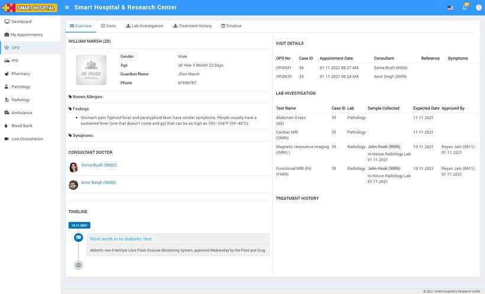**

---

### **Visits**

Under visit section, patient can see all their Recheckups.  
  
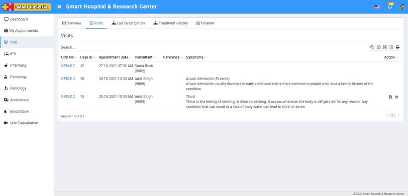  
  
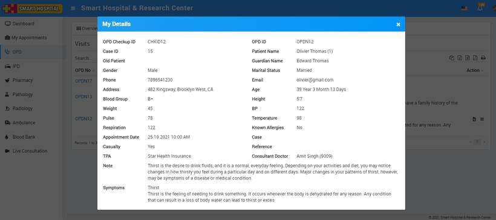

---

### **Charges**

All the added charge of patient can be check from Charges tab. Patient can also print charges from print button icon present at **Action** column.  
  
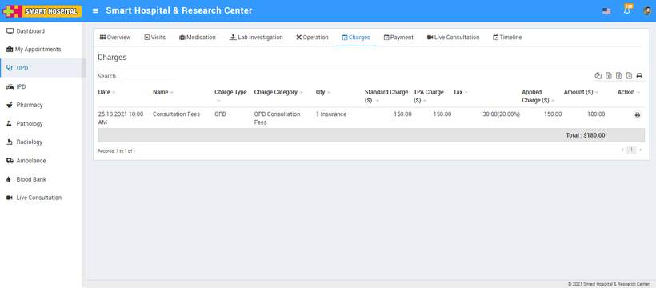

---

### **Payment**

Patient can check all the payment details done from patient side. Patient can also print Payment from print button icon present at **Action** column.  
  
  
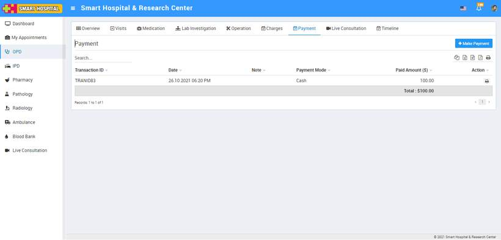  
  
To make online payment click on **+** **Make Payment** button. Here add Payment Amount and click on **Add** button.  
  
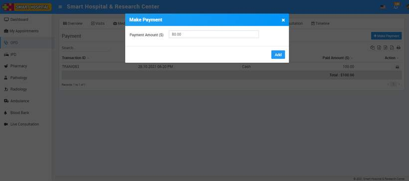

This will redirect to the payment page where patient can make online payment through selected payment method.  
  

---

### **Lab Investigation**

At this tab patient can check their reports of Pathology and Radiology tests.  
  
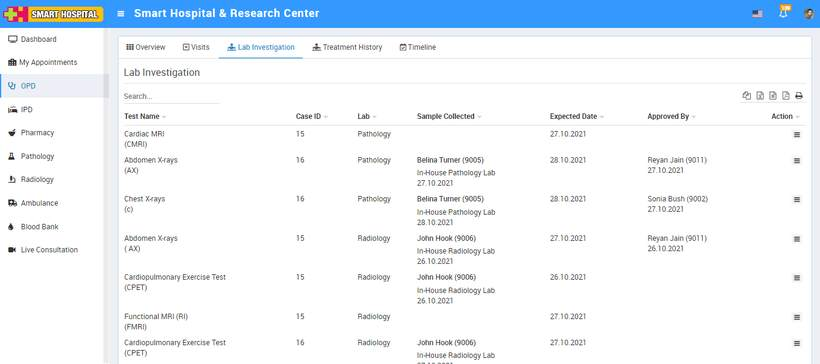  
  
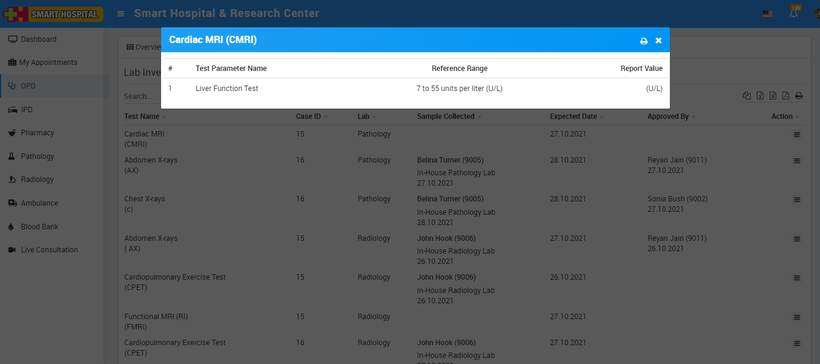

---

### **Timeline**

In Timeline section patient can see notes or quick access notes created from admin or staff panel.  
  
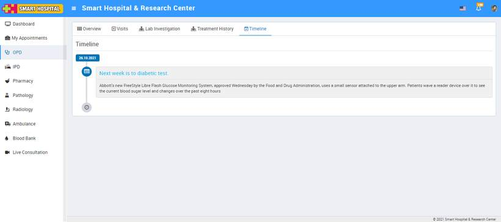

---

### **Medication**

Medication is for comparing a patient's medication orders to all of the medications that the patient has been taking.

Under Medication patient can check all their medication routine which was given to the patient.  
  
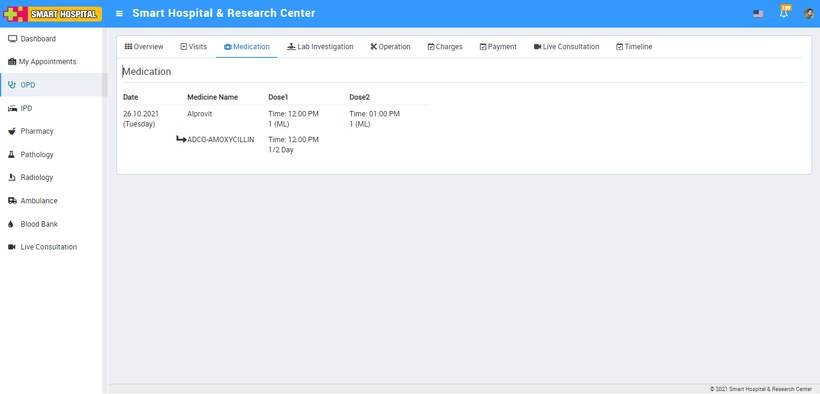  
  

---

### **Operation Theatre**

Under Operation Theatre tab patient can check details of their all operation done under OPD.

---

### **Live Consultation**

Using Live Consultation Patients can consult to doctor through zoom video call. From Live Consultation tab patient can check all their upcoming and previous Live Consultation.

**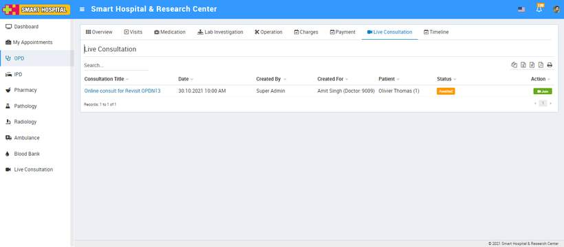**
