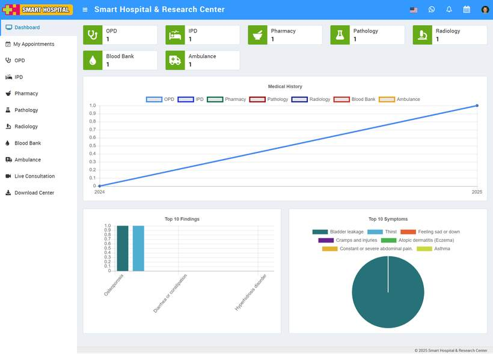

# Patient Dashboard

_Fri, 01 Aug, 2025_ · [Patient Panel (10)](https://smart-hospital.in/category/patient-panel) · vendor article: https://smart-hospital.in/article/patient-dashboard

### Patient Dashboard

Fri, 01 Aug, 2025

[Articles](https://smart-hospital.in/articles)[Patient Panel](https://smart-hospital.in/category/patient-panel)

---

At patient panel you will see **Dashboard**, here patient can see all their treatment details in summarized form.  
  
At the top you will see tabs like **OPD, IPD, Pharmacy, Pathology, Radiology, Blood Bank** and **Ambulance**, here you can see total count for patient treatment under these tabs.   
  
In below you will see graphic representation of quantitative information for Medical History, Findings and Symptoms through Pie Chart, Bar Chart etc.  
  
  

