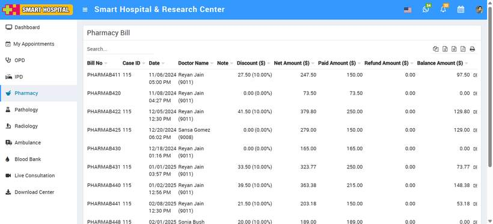
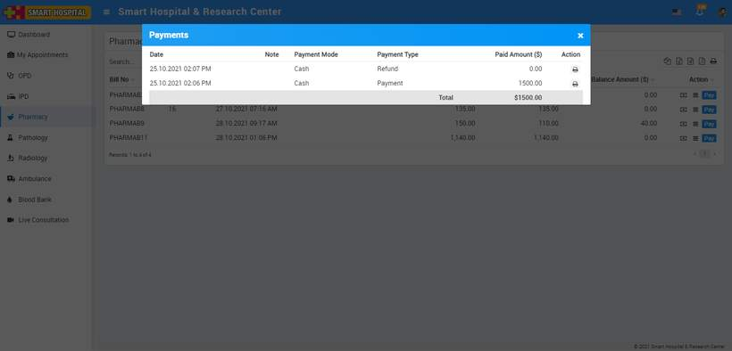
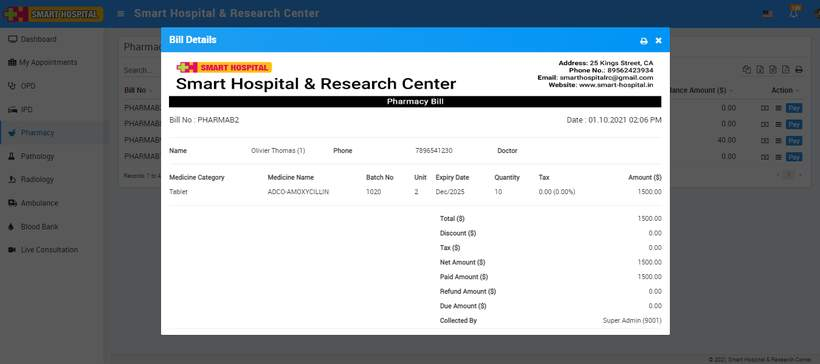
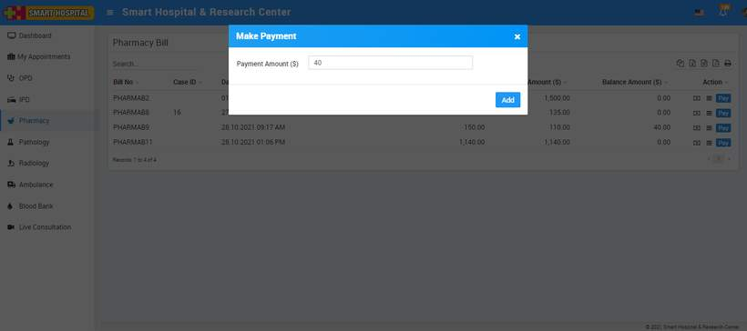
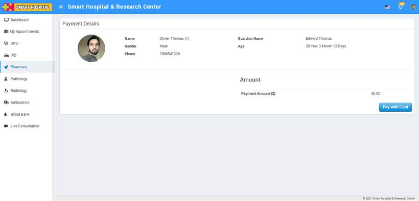

# Pharmacy

_Fri, 01 Aug, 2025_ · [Patient Panel (10)](https://smart-hospital.in/category/patient-panel) · vendor article: https://smart-hospital.in/article/pharmacy-1

### Pharmacy

Fri, 01 Aug, 2025

[Articles](https://smart-hospital.in/articles)[Patient Panel](https://smart-hospital.in/category/patient-panel)

---

To check Pharmacy bill, go to Pharmacy here you can check Pharmacy bill details like **Bill No., Case Id, Date, Doctor Name, Note, Discount, Net Amount, Paid Amount Refund Amound and Balance Amount**.   
  

To view paid payment details, click on View Payment icon here you can check paid payments by patient and also print them from print button present at **Action** column.  
  

From **Show** icon you can check all medicine details and bill details. You can also print them from print icon present at top right side at header.  
  

From **Pay** button, patient can make online payment for their medicine bill. To pay online click on **Pay** button it will redirect you to payment gateway from where patient can make online payment.  
  
  
  

