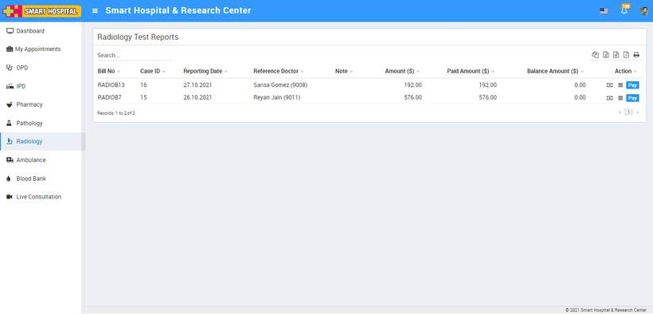
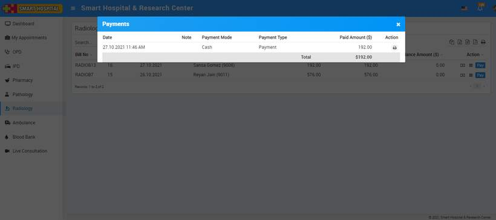
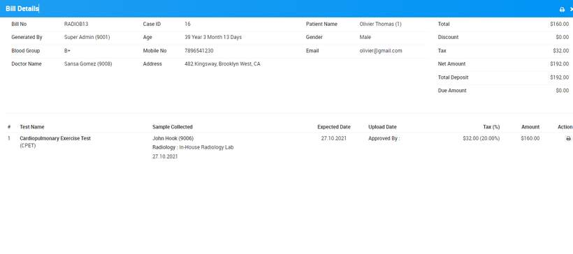
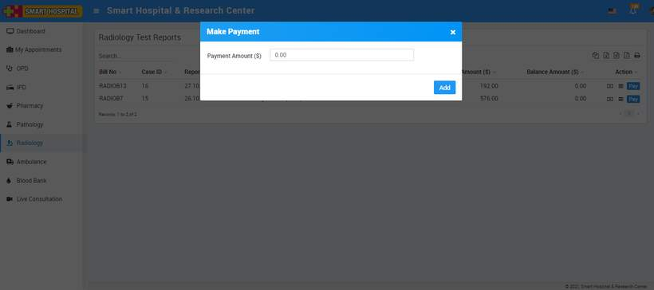

# Radiology

_Thu, 18 Nov, 2021_ · [Patient Panel (10)](https://smart-hospital.in/category/patient-panel) · vendor article: https://smart-hospital.in/article/radiology-1

### Radiology

Thu, 18 Nov, 2021

[Articles](https://smart-hospital.in/articles)[Patient Panel](https://smart-hospital.in/category/patient-panel)

---

To check Radiology test reports bill details at patient panel go to Radiology, here you can check patient Radiology test report bill details like **Bill No, Case ID, Reporting Date, Reference Doctor, Note, Amount, Paid Amount  and Balance Amount**.  
  

To view payment details click on View Payment button available on **Action** column. To print this payment details you can print on print button icon.  
  

To view **Radiology** report bill details click on Show button present at **Action** column. To print bill click on print button present at top right side on the header.  
  

To make online payment for Radiology click on **Pay** button here you can edit payment and click on add button, this will redirect you to payment gateway from where you can make online payment for **Radiology**.  
  

