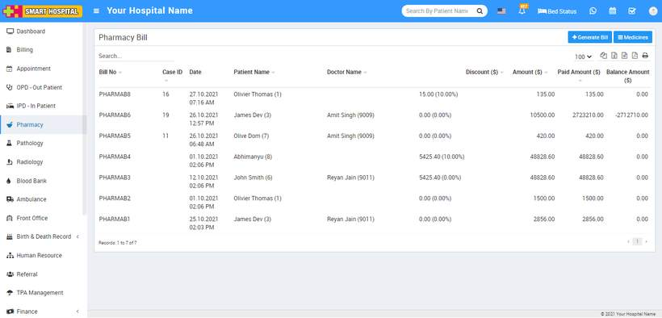

# About Pharmacy.

_Thu, 11 Nov, 2021_ · [Pharmacy (6)](https://smart-hospital.in/category/pharmacy) · vendor article: https://smart-hospital.in/article/about-pharmacy

### About Pharmacy.

Thu, 11 Nov, 2021

[Articles](https://smart-hospital.in/articles)[Pharmacy](https://smart-hospital.in/category/pharmacy)

---

Pharmacy module is for managing medicines stock, selling and generating medicine bill.

Managing medicines click on Medicines button. You can see all medicine list with their name and available stock here. If a medicine row shows as white color means it’s a stock is normal, if row color is sky blue it means its stock is below than reorder level, if row color is yellow means its stock below to minimum level and if row color is red that means medicine is out of stock.  
  
  
  
Note - Please [click here](https://smart-hospital.in/article/pharmacy) to see setup for Pharmacy.
