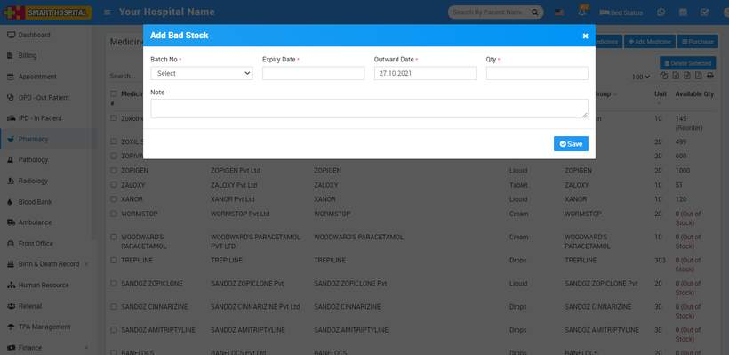
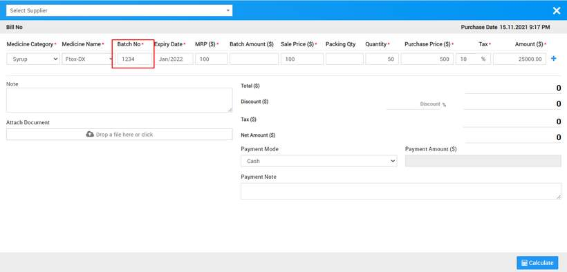

# How to add Medicine Bad Stock?

_Mon, 15 Nov, 2021_ · [Pharmacy (6)](https://smart-hospital.in/category/pharmacy) · vendor article: https://smart-hospital.in/article/how-to-add-medicine-bad-stock

### How to add Medicine Bad Stock?

Mon, 15 Nov, 2021

[Articles](https://smart-hospital.in/articles)[Pharmacy](https://smart-hospital.in/category/pharmacy)

---

In Smart Hospital you can add medicine Bad Stock for those medicine which are indicating "Out of stock". To add medicine bad stock or return stock click on **+ Add Bad Stock** button here enter **Batch Number, Expiry Date, Outward Date Quantity** and **Note.  
  
**To get Batch Number go to **Pharmacy > Medicine > Purchase > Purchase Medicine** here enter medicine details with batch number for purchasing medicine which will you can see at Batch Number drop down at Add Bad Stock**.  
  
**
