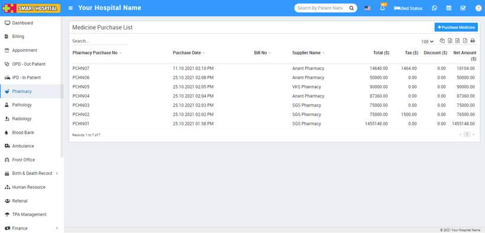
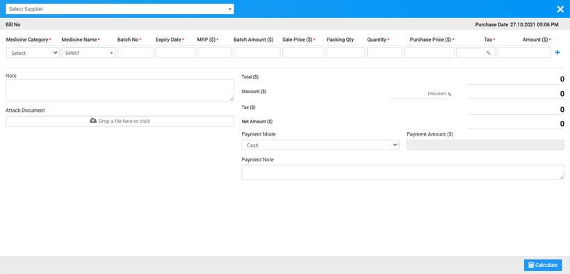

# How to add Medicine Stock?

_Wed, 27 Oct, 2021_ · [Pharmacy (6)](https://smart-hospital.in/category/pharmacy) · vendor article: https://smart-hospital.in/article/how-to-add-medicine-stock

### How to add Medicine Stock?

Wed, 27 Oct, 2021

[Articles](https://smart-hospital.in/articles)[Pharmacy](https://smart-hospital.in/category/pharmacy)

---

To add medicine stock you should enter purchased medicine details, for this click on **Purchase** button here you can see list of purchased medicines.  
  
  
  
To add purchased medicine details click **+ Purchase Medicine** button now here enter **Supplier name, Purchase Date, Medicine Category, Medicine Name, Batch No, Expiry Date, MRP($), Batch Amt, Sale Price($), Packing Qty, Quantity, Purchase Price($), Amount($), Note, Attach document, Discount, Tax**. After filling all relevant details, click on calculate button then final amount will be calculated then click on **Save** button.  
  

