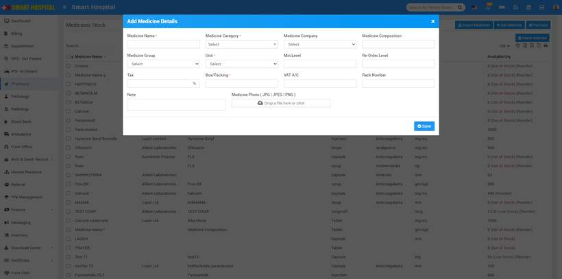
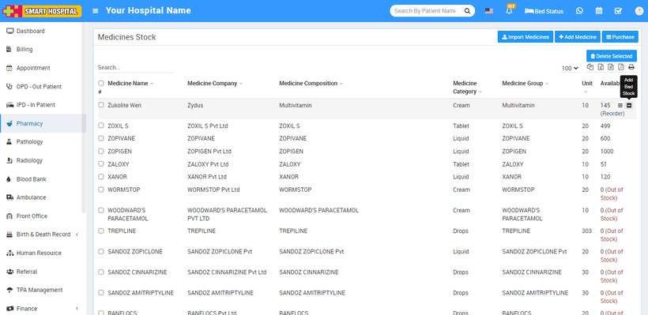
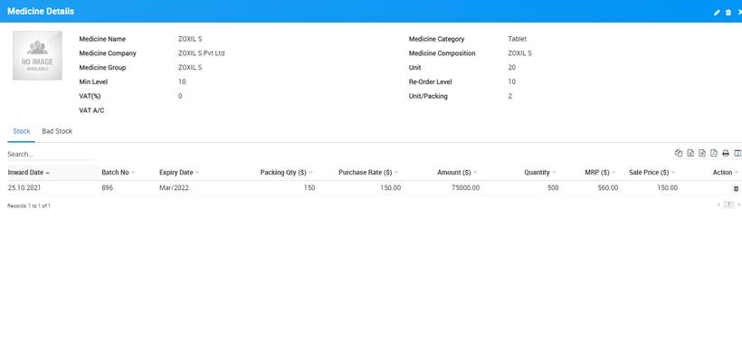

# How to add new Medicine?

_Mon, 10 Jun, 2024_ · [Pharmacy (6)](https://smart-hospital.in/category/pharmacy) · vendor article: https://smart-hospital.in/article/how-to-add-new-medicine

### How to add new Medicine?

Mon, 10 Jun, 2024

[Articles](https://smart-hospital.in/articles)[Pharmacy](https://smart-hospital.in/category/pharmacy)

---

To add new medicine click on **+ Add Medicine** button here enter **Medicine Name, Medicine Category, Medicine Company, Medicine Composition, Medicine Group, Supplier, Unit, Minimum Level, Reorder Level, Tax, Box/Packing, VAT Account, Rack Number, Note** and **Medicine Photo.**  
  
To see medicine details and stock entry click on **Show** button, here you can also check medicine stock entry and bad stock entry details.  
  
  
  

