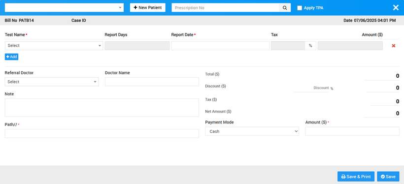
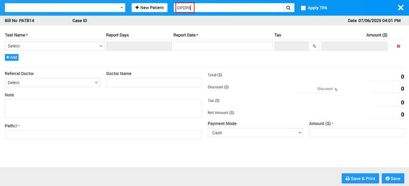

# How to generate Pharmacy Bill?

_Sun, 06 Jul, 2025_ · [Pharmacy (6)](https://smart-hospital.in/category/pharmacy) · vendor article: https://smart-hospital.in/article/how-to-generate-pharmacy-bill

### How to generate Pharmacy Bill?

Sun, 06 Jul, 2025

[Articles](https://smart-hospital.in/articles)[Pharmacy](https://smart-hospital.in/category/pharmacy)

---

In Pharmacy there are two ways to generate Pharmacy bill that are generate pharmacy bill manually or you can generate patient pharmacy bill through their prescription id.

So for manually generate medicine sales bill click on Generate Bill button at pharmacy bill page, here first select patient or add new patient to generate patient pharmacy Bill from **+New Patient** button here bill no will be auto generated Number so you need to add **Medicine Category, Medicine Name, Batch Number, Quantity, Sale Price, Tax Amount**. To add more medicine click on "**+Add**" button, you can also select the **TPA** option which is showing on the top right if TPA is applicable for this patient then add **Hospital Doctor, Doctor Name, Note**, custom field details (if any) then after adding all medicine enter **Discount and Tax** if any, to calculate final bill click on **Calculate** button then click on **Save** button. After this bill will be display on pharmacy bill page. To see bill details click on **Show** button now here you can also Print medicine bill.  
  

Now there is another way to generate pharmacy bill, through prescription id. So if doctor prescribed medicines for patient from OPD or IPD prescription then pharmacist can generate pharmacy bill only through prescription id (you can find prescription id at prescription details page).

To generate pharmacy bill through prescription id, click on Generate Bill button at pharmacy bill page, here enter **Prescription ID** so all the doctor’s prescribed medicines will auto fetch here at generate bill page then to add more medicine click on "**+Add**" button,  add **Hospital Doctor, Doctor Name, Note**, custom field details (if any) then after adding all medicine enter **Discount** and **Tax** if any to calculate final bill click on Calculate button then click on **Save** button. After this bill will be display on pharmacy bill page. To see bill details click on **Show** button now here you can also Print medicine bill.  
  

