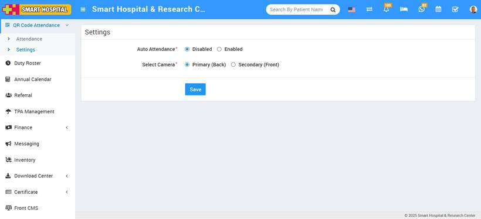
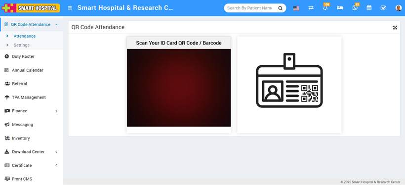
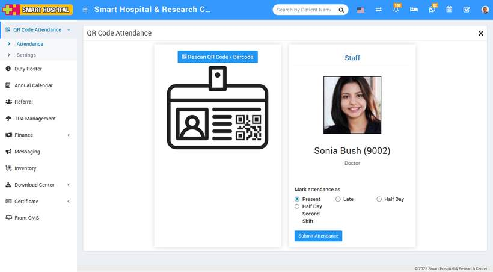
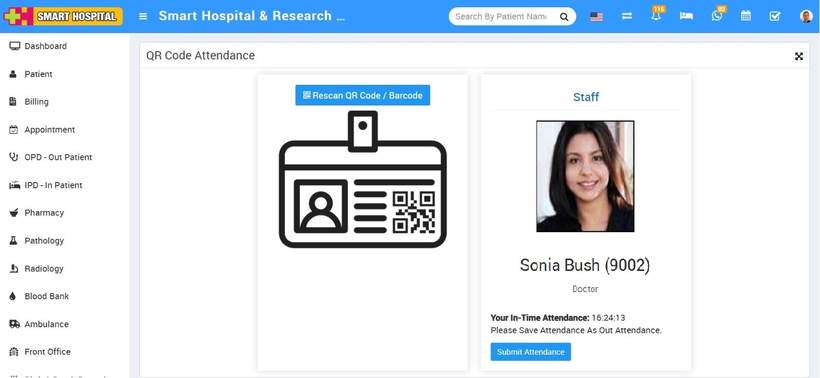
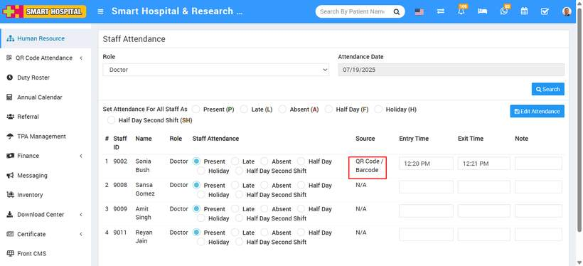

# How to disable the auto attendance and mark the attendance of hospital staff using QR Code / Barcode?

_Sat, 16 Aug, 2025_ · [QR Code Attendance (3)](https://smart-hospital.in/category/qr-code-attendance) · vendor article: https://smart-hospital.in/article/how-to-disable-the-auto-attendance-and-mark-the-attendance-of-hospital-staff-using-qr-code-barcode

### How to disable the auto attendance and mark the attendance of hospital staff using QR Code / Barcode?

Sat, 16 Aug, 2025

[Articles](https://smart-hospital.in/articles)[QR Code Attendance](https://smart-hospital.in/category/qr-code-attendance)

---

To disable the auto attendance, go to **QR Code Attendance > Setting**.  
  
  
  
On the right side, the setting page will open. Here you can see the **Auto Attendance Disabled and Enabled** options available. Simply click on the **Disabled** option and auto attendance will be disabled. Now, you will not be able to mark the attendance automatically.

Now see how it works. Simply go to **QR Code Attendance > Attendance**. Here, the QR Code Attendance page will open, and on this page, you will see one scanner is open.  
  

Now, you are ready to mark the attendance. Simply take the **staff ID card** on which the QR Code / Barcode is already displayed. Just show the ID card in front of the scanner, and the scanner will scan the QR Code / Barcode. Then the manual option for marking attendance will be shown on the same page.

Now, you can view some details of the **staff**, such as the staff image, name, staff ID. Below, you can see the attendance options available. Simply mark the attendance as **Present, Late, or Half Day**, depending on the time of attendance, and click on the **Submit Attendance** button. Attendance will be submitted successfully, and a message will also be displayed on the screen.  
  

If you wish to rescan the same ID card of the staff member, click on the **Rescan QR Code / Barcode** button located at the top. The scanner will open, proceed to scan the ID card again. This time, a message will be displayed that **Attendance has already been submitted as Present, Late, or Half Day**.

Now, rescan the staff ID card.  
  
  
  
  
To verify the attendance that you marked using the QR Code / Barcode of the staff, simply go to **Human Resource > Staff Attendance**.  
  
  
  
  
Simply, search the attendance you marked by scanning the QR Code / Barcode. Select the **Role** of the staff and the **Attendance Date**, then click on the **Search** button. The list along with their attendance will be displayed below. In the **Source** column, the type of attendance will be shown — here we marked the attendance through the **QR Code / Barcode**.  
  

On this page, you can verify the attendance of the staff whose ID card was scanned, and the attendance status will be displayed, indicating whether the staff was **Present, Late, or Half Day**. You can also verify the **Date, Time, and Source** of the attendance on this page.
