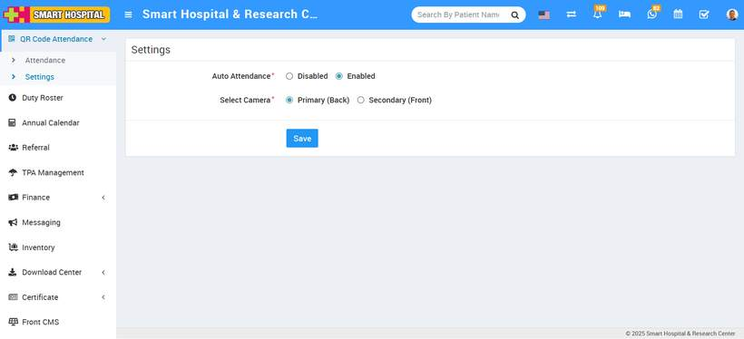
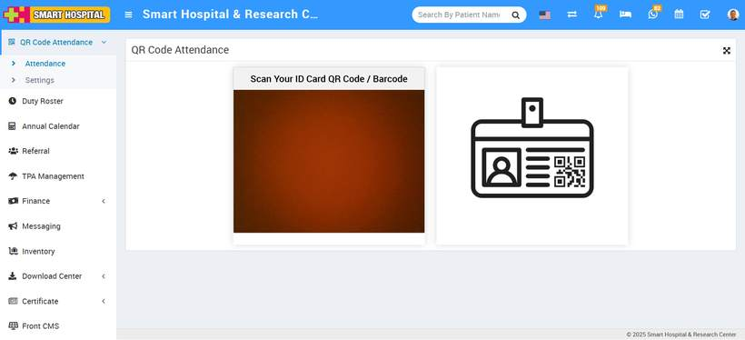
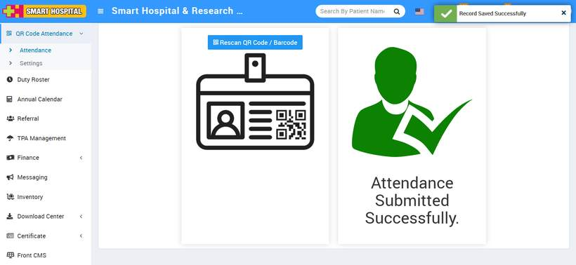
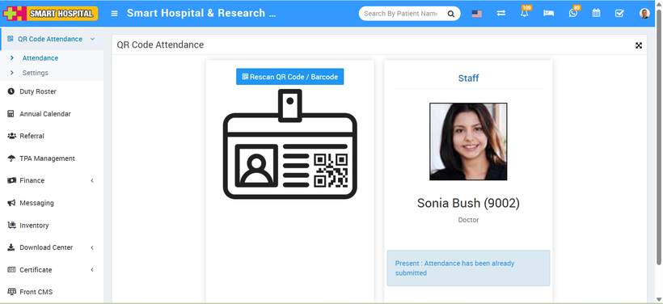
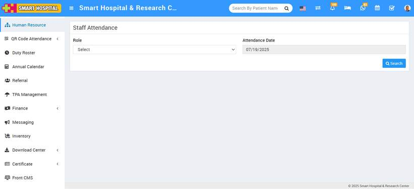

# How to enable the auto attendance and mark the attendance of hospital staff using QR Code / Barcode

_Sat, 16 Aug, 2025_ · [QR Code Attendance (3)](https://smart-hospital.in/category/qr-code-attendance) · vendor article: https://smart-hospital.in/article/how-to-enable-the-auto-attendance-and-mark-the-attendance-of-hospital-staff-using-qr-code-barcode

### How to enable the auto attendance and mark the attendance of hospital staff using QR Code / Barcode

Sat, 16 Aug, 2025

[Articles](https://smart-hospital.in/articles)[QR Code Attendance](https://smart-hospital.in/category/qr-code-attendance)

---

To enable the auto attendance, go to **QR Code Attendance > Setting**. When you click on the **Setting** button, the setting page will open on the right side. Here, you can see the **Auto Attendance Disabled and Enabled** options available.  
  

Simply click on **Enabled**, and you will now be able to mark the attendance automatically. Just scan the **QR Code / Barcode** on the staff ID card, and the attendance will be marked automatically.

Now see how it works. Simply go to **QR Code Attendance > Attendance**.  
  
  
  
Here, the QR Code Attendance page will open. On this page, you will see the **scanner** open and ready. Now you are ready to mark the attendance. Simply take the **staff ID card** on which the QR Code / Barcode is already printed. Show the ID card in front of the scanner, and the scanner will read the QR Code / Barcode. The attendance will be **marked automatically**, and a message will be shown as **"Attendance Submitted Successfully".  
  
**

**Note:**  
When you scan the QR Code / Barcode to mark attendance, the scanner will automatically reopen for scanning the next QR Code / Barcode until you close the page. After marking attendance, the scanner will take approximately **five seconds** to reset and reopen.

If you wish to rescan the same ID card of a staff member, click on the **Rescan QR Code / Barcode** button located at the top. The scanner will open again, and you can proceed to scan the ID card. This time, a message will be displayed that **"Attendance has already been submitted** , reflecting the previously marked status.  
  

---

### **To verify the attendance marked for hospital staff**

Go to **Human Resource > Staff Attendance**.  
  
  
  
Search for the **role of the staff** (e.g., Nurse, Doctor, Receptionist, etc.) and select the **attendance date**, then click on the **Search** button. The attendance will be displayed below.  
  

On this page, you can verify the attendance of the **staff member** whose ID card was scanned. The attendance status will be displayed, indicating whether the staff was **Present, Late, or Half-Day**. You can also verify the **attendance date** and **source** (QR Code / Barcode) that was used to mark the attendance.
