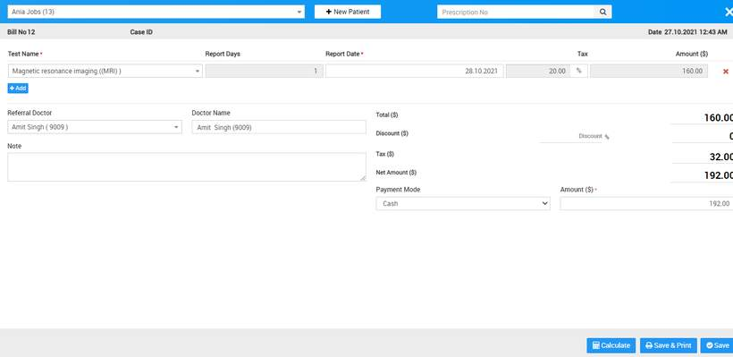
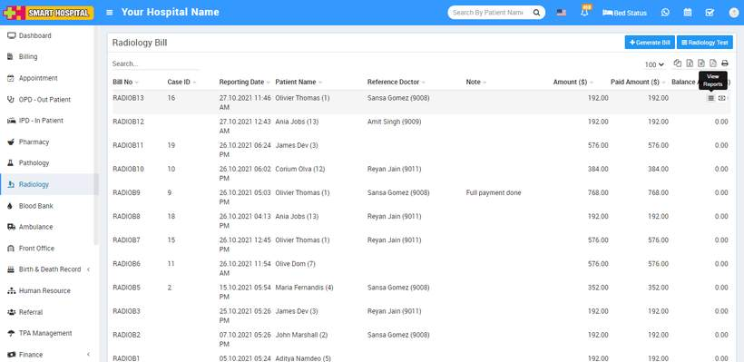
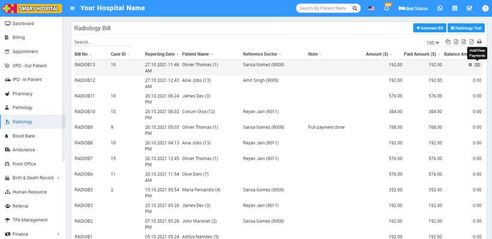
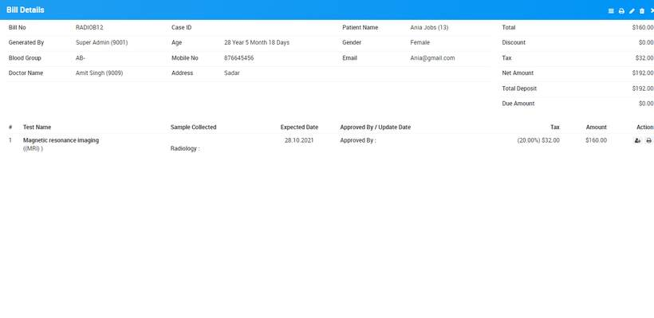
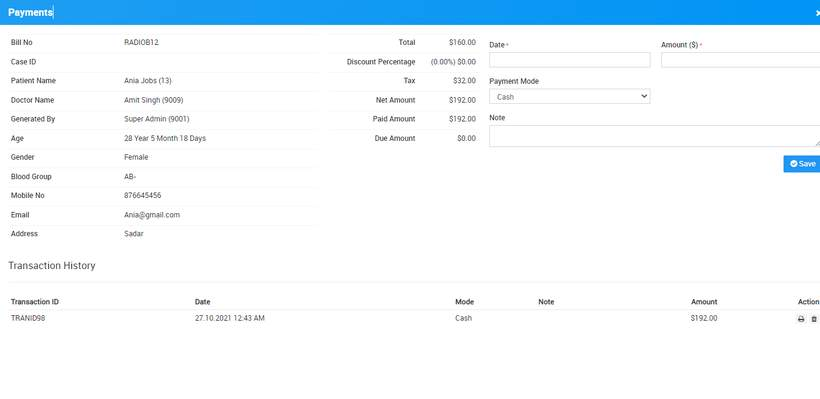
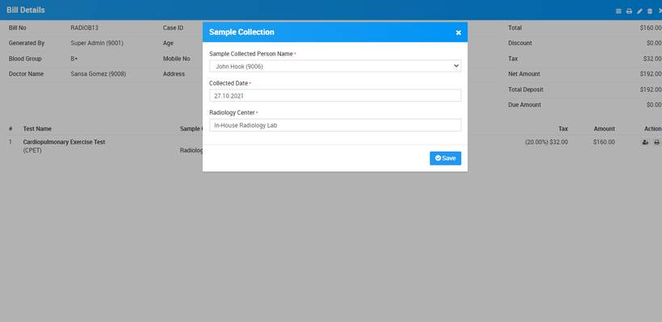
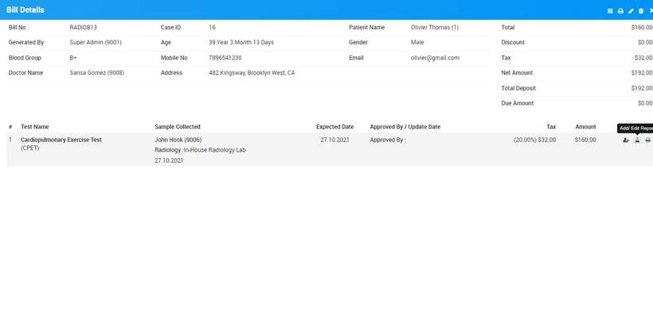
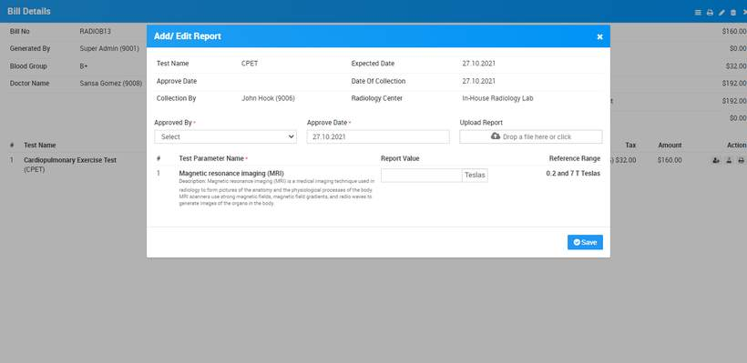
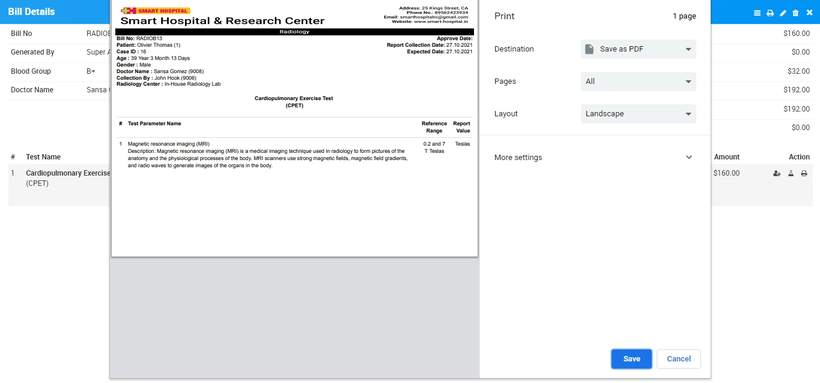
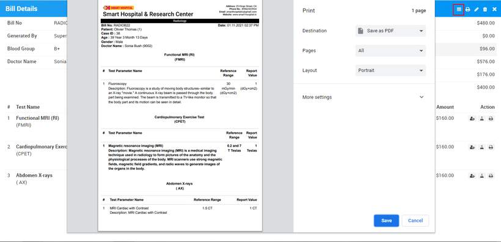

# How to add and generate patient Radiology test report in Smart Hospital?

_Wed, 10 Nov, 2021_ · [Radiology (4)](https://smart-hospital.in/category/radiology) · vendor article: https://smart-hospital.in/article/how-to-add-and-generate-patient-radiology-test-report-in-smart-hospital

### How to add and generate patient Radiology test report in Smart Hospital?

Wed, 10 Nov, 2021

[Articles](https://smart-hospital.in/articles)[Radiology](https://smart-hospital.in/category/radiology)

---

To add patient test report for a radiology test, first you need to generate a Radiology Test bill. So to generate radiology test bill click on **+ Generate Bill** button present at Radiology page here enter Patient (patient can be added here in three ways 1. Search for patient at search area. 2. Add new patient through **+New Patient** and 3. Enter **Prescription No.** so patient details with prescribed test will auto fill at generate bill), **Test Name, Reports Days, Report Date, Tax, Amount, Hospital Doctor** and **Doctor Name**, custom field details (if any) then after adding all pathology test details enter **Discount** and **Tax** if any, now to calculate final bill click on **Calculate** button then click on Save button. After this, bill will be display on Radiology page.  
  
  
  

Now after generate radiology bill there two option will be show, these are **View Reports** and **Add/View Payment.  
  
  
  
  
**  
  
To View Reports click on **View Reports** icon here you can view bill details, to print bill click on Print icon present at top right corner, to edit bill click on Edit icon present at top right corner and for delete bill click on Delete icon present at top right corner.  
  

There is one more section at Bill Details under test details section where you can add/edit Sample Collection Person details and Print Report.  
  

To Add/Edit Collection Person details, click on **Add/Edit Collection Person** details button icon present at **View Reports** Page, here Add/Edit **Sample Collected Person Name, Collected Date, Radiology Center** then click on **Save** button.  
  
  
  
Once you have added Collection Person details and click on Save button so you will see one more option at bill detail page which is **Add/Edit Report** from this option radiologist/staff can add patient test result report**.   
  
**To add patient test result click on **Add/Edit Report**button. Here enter details like **Approved By, Approve Date, Upload Report** and **Test Parameter value** under **Report Value** field and click on **Save** button.  
  
**Note -** Please [click here](https://smart-hospital.in/article/radiology) to see how to add Test Parameter values in Smart Hospital.  
  

Now to print Radiology Test report click on Print button present at Action column at Test details under **View Report** page.  
  
  
  
  
  
To print multiple test report in a single page click on **Print Test Report** icon present at top of the page.  
  

