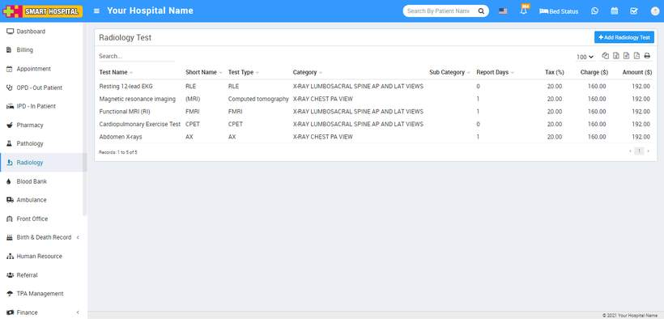
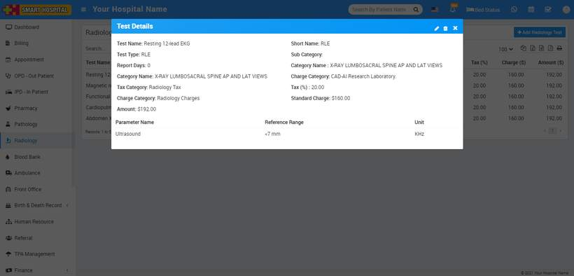

# How to add radiology test in Smart Hospital?

_Wed, 10 Nov, 2021_ · [Radiology (4)](https://smart-hospital.in/category/radiology) · vendor article: https://smart-hospital.in/article/how-to-add-radiology-test-in-smart-hospital

### How to add radiology test in Smart Hospital?

Wed, 10 Nov, 2021

[Articles](https://smart-hospital.in/articles)[Radiology](https://smart-hospital.in/category/radiology)

---

Radiology module is for managing patient radiology test and reports.

To add radiology test go to Radiology here click on Radiology Test then click on **+ Add Radiology Test** button here enter **Test Name, Short Name, Test Type, Category Name, Charge Name, Tax (%), Standard Charge, Amount**. To add Test Parameter select Test Parameter Name. Click on **+ Add** button and add multiple Test Parameter.  
  

Added **Radiology** **Test** will be list on **Radiology** test page.  
  

To view details of added Test click on View icon show on mouse hover at last column.  
  

