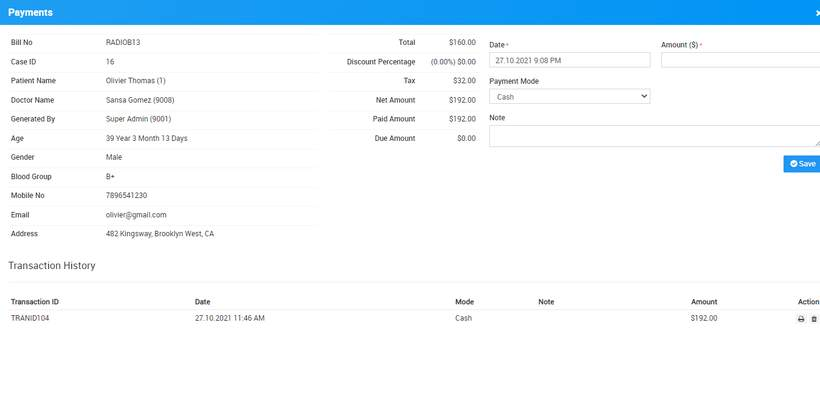

# How to add/view radiology test payment?

_Wed, 10 Nov, 2021_ · [Radiology (4)](https://smart-hospital.in/category/radiology) · vendor article: https://smart-hospital.in/article/how-to-addview-radiology-test-payment

### How to add/view radiology test payment?

Wed, 10 Nov, 2021

[Articles](https://smart-hospital.in/articles)[Radiology](https://smart-hospital.in/category/radiology)

---

To Add/View patient payment of Radiology Test go to **Radiology > Add/View Payments**. Here enter payment details like payment **Date, Amount, Payment Mode, Note** and then click on **Save** button.  
  
  
  
Here at **Transaction History** section you can check all patient payment done for **Radiology Test**.
