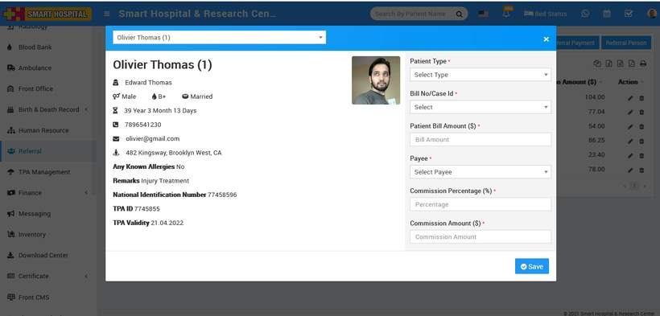

# How to add Referral Payment?

_Sun, 31 Oct, 2021_ · [Referral (3)](https://smart-hospital.in/category/referral) · vendor article: https://smart-hospital.in/article/how-to-add-referral-payment

### How to add Referral Payment?

Sun, 31 Oct, 2021

[Articles](https://smart-hospital.in/articles)[Referral](https://smart-hospital.in/category/referral)

---

Now to add Referral Payment go to Referral module then click on **+Add Referral Payment** button. Here add **Patient, Patient Type, Bill No/Case Id, Patient Bill Amount, Payee, Commission Percentage (%), Commission Amount** and then click on **Save** button.  
  

This added record will show at Referral List page.  
  

To edit Referral Payment details click on **Edit** button, edit details and save it and for delete Referral Payment click on **Delete** button present at **Action** column.
