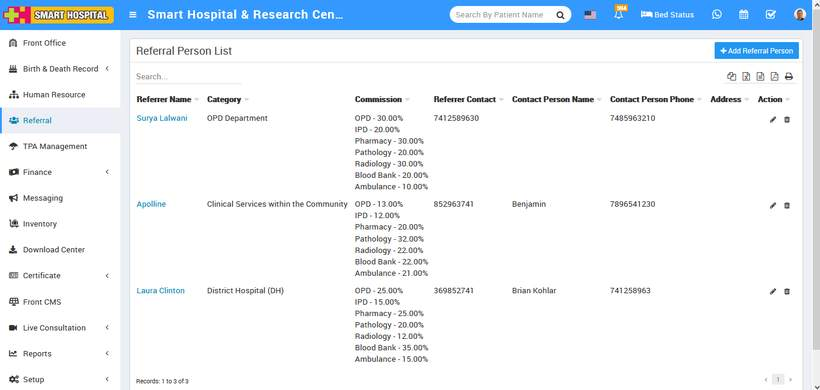

# How to add Referral Person?

_Sun, 31 Oct, 2021_ · [Referral (3)](https://smart-hospital.in/category/referral) · vendor article: https://smart-hospital.in/article/how-to-add-referral-person

### How to add Referral Person?

Sun, 31 Oct, 2021

[Articles](https://smart-hospital.in/articles)[Referral](https://smart-hospital.in/category/referral)

---

To Add Referral Person click on **Referral** link present at the side menu then click on **Referral Person** and then click on **+Add Referral Person** button, here enter **Referrer Name**, **Referrer Contact**, **Contact Person Name**, **Contact Person** **Phone**, **Category**, **Standard** **Commission** **(%),** **Address** and **Commission** **for Modules (%)** details and click on **Save** button.  
  

This added referral record you can see at Referral Person list page.  
  

To edit Referral Person details click on **Edit** button, edit details and save it and for delete Referral Person click on **Delete** button present at referral Person list under Action column.
