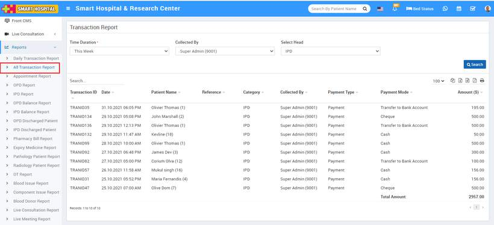

# All Transaction Report.

_Fri, 01 Aug, 2025_ · [Reports (44)](https://smart-hospital.in/category/reports) · vendor article: https://smart-hospital.in/article/all-transaction-report

### All Transaction Report.

Fri, 01 Aug, 2025

[Articles](https://smart-hospital.in/articles)[Reports](https://smart-hospital.in/category/reports)

---

To check Transaction report of patient, go to **Reports > All Transaction Report**. Here select the **Time Duration, Collected By** and **Select Head (Optional)** and then click on**Search** button. Here you can see patients transaction details for different treatments like for OPD, IPD, Pharmacy Bill, Pathology Test, Radiology Test, Blood Issue, Ambulance Call, Income. Expenses, Payroll Report.  
  
**Note:** In the **All Transactions Report**, all **refunds** will be displayed with a **negative sign (-)** to indicate the reversal of payment.  
  

