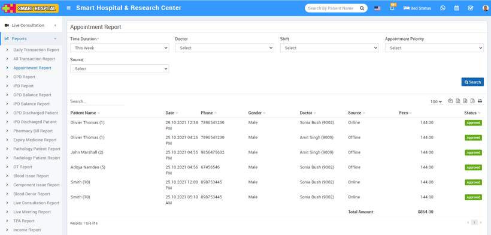

# Appointment Report

_Fri, 29 Oct, 2021_ · [Reports (44)](https://smart-hospital.in/category/reports) · vendor article: https://smart-hospital.in/article/appointment-report

### Appointment Report

Fri, 29 Oct, 2021

[Articles](https://smart-hospital.in/articles)[Reports](https://smart-hospital.in/category/reports)

---

To check patient’s Appointment report, go to **Reports > Appointment Report**. Here select the **Time Duration, Doctor,** **Shift, Appointment Priority, and Source** then click on**Search** button. Here you can see patient’s Appointments details like **Patient Name, Date, Phone, Gender, Doctor, Source, Appointment Details, Fees** **and** **Status** etc.  
  

