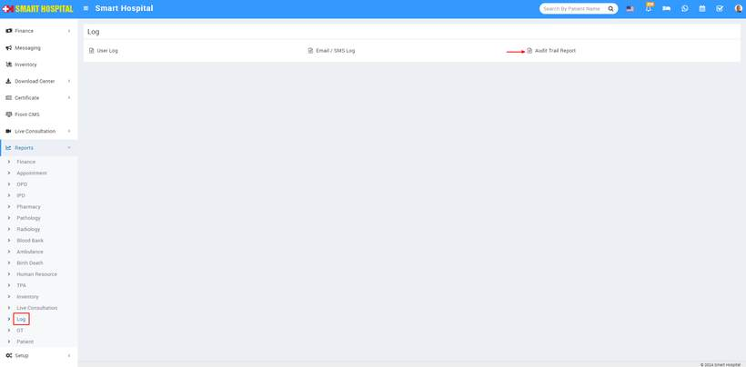
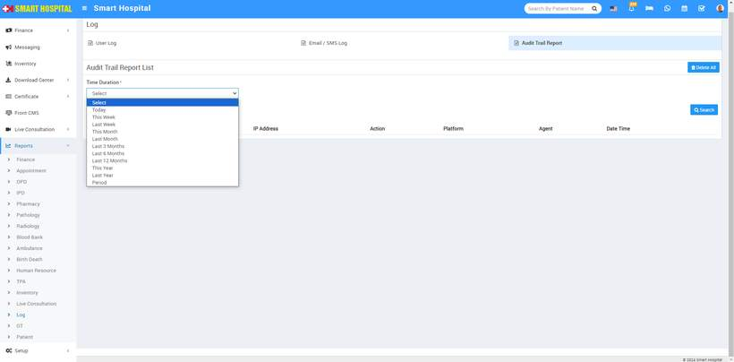
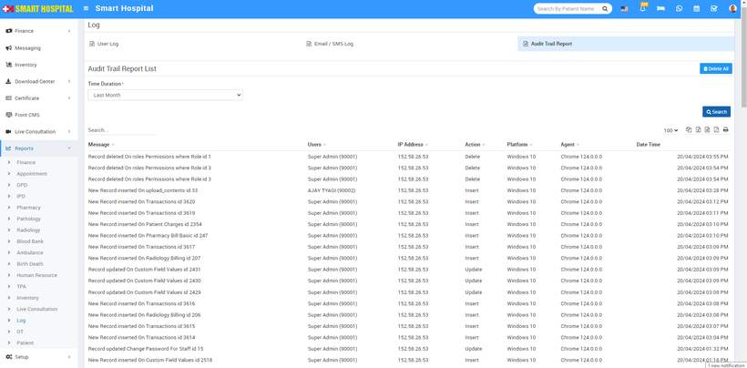

# Audit Trail Report

_Fri, 24 May, 2024_ · [Reports (44)](https://smart-hospital.in/category/reports) · vendor article: https://smart-hospital.in/article/audit-trail-report

### Audit Trail Report

Fri, 24 May, 2024

[Articles](https://smart-hospital.in/articles)[Reports](https://smart-hospital.in/category/reports)

---

To check Audit Trail report, go to **Reports > Log > Audit Trail Report**.   
  
  
  
Now click on **Audit Trail Report**, **Time Duration** drop down will be display  
  
  
  
Here, select the time duration for which you want to see the Audit Trail report  then click on Search button, all details will be generated and display below. you can see **Inventory Item** details like **Message, Users, IP Address, Action, Platform, Agent, Date - Time** etc. Also download this report as PDF.  
  
  
  
To delete all audit trail record there is Delete All button is available at top right corner of the Audit Trail report page.
