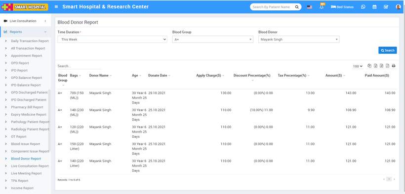

# Blood Donor Report

_Sat, 30 Oct, 2021_ · [Reports (44)](https://smart-hospital.in/category/reports) · vendor article: https://smart-hospital.in/article/blood-donor-report

### Blood Donor Report

Sat, 30 Oct, 2021

[Articles](https://smart-hospital.in/articles)[Reports](https://smart-hospital.in/category/reports)

---

To check Component Issue report, go to **Reports >** **Blood Donor****Report**. Here select the **Time Duration, Blood Group and Blood Donor** then click on**Search** button. Here you can see Blood Donor details like **Blood Group, Bags, Donor Name, Age, Donate Date, Apply Charges, Discount Percentage, Tax Percentage, Amount, Paid Amount** etc. Also you can download this report as PDF.  
  

