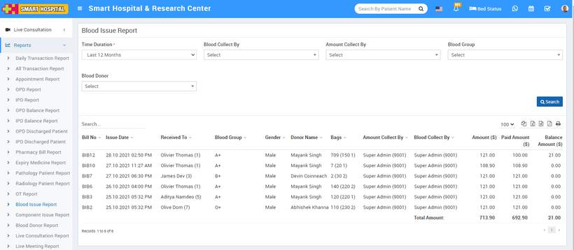

# Blood Issue Report

_Sat, 30 Oct, 2021_ · [Reports (44)](https://smart-hospital.in/category/reports) · vendor article: https://smart-hospital.in/article/blood-issue-report

### Blood Issue Report

Sat, 30 Oct, 2021

[Articles](https://smart-hospital.in/articles)[Reports](https://smart-hospital.in/category/reports)

---

To check Blood Issue Report, go to **Reports >** **Blood Issue** **Report**. Here select the **Time Duration, Blood Collected By, Amount Collected By Blood Group and Blood Donor** then click on**Search** button. Here you can see Blood Issue Report details like **Bill No, Issue Date, Received To, Blood Group, Donor Name, Blood Collected By, Amount Collected By, Amount, Paid Amount, Balance Amount** etc. Also you can download this report as PDF.  
  

