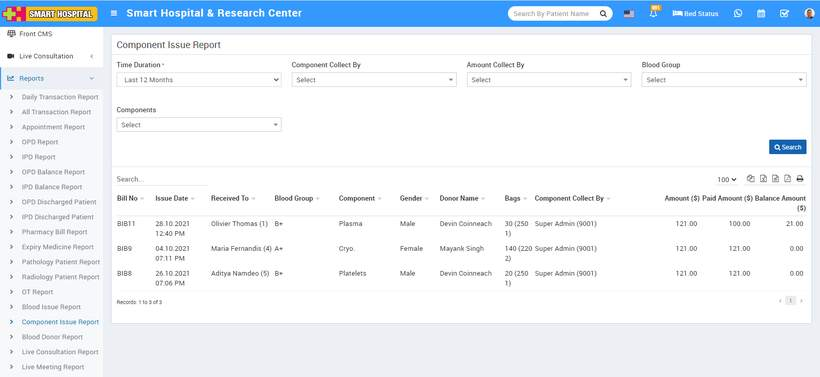

# Component Issue Report

_Sat, 30 Oct, 2021_ · [Reports (44)](https://smart-hospital.in/category/reports) · vendor article: https://smart-hospital.in/article/component-issue-report

### Component Issue Report

Sat, 30 Oct, 2021

[Articles](https://smart-hospital.in/articles)[Reports](https://smart-hospital.in/category/reports)

---

To check Component Issue report, go to **Reports >** **Component Issue** **Report**. Here select the **Time Duration, Component Collected By, Amount Collected By, Blood Group and Component** then click on**Search** button. Here you can see Component details like **Bill No, Issue Date, Received To, Component, Bags, Amount, Paid Amount and Balance Amount** etc. Also you can download this report as PDF.  
  

