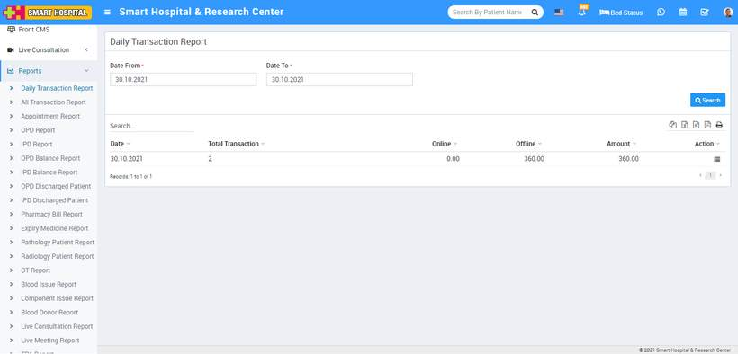
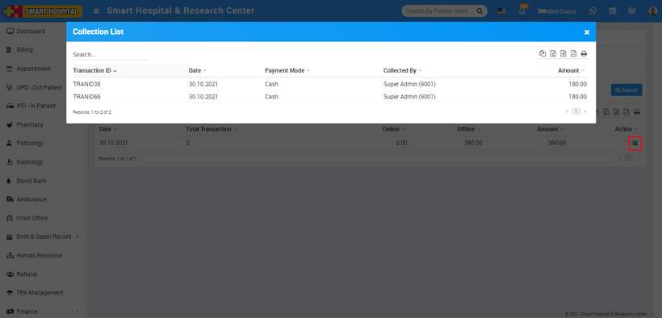

# Daily Transaction Report

_Sat, 30 Oct, 2021_ · [Reports (44)](https://smart-hospital.in/category/reports) · vendor article: https://smart-hospital.in/article/daily-transaction-report

### Daily Transaction Report

Sat, 30 Oct, 2021

[Articles](https://smart-hospital.in/articles)[Reports](https://smart-hospital.in/category/reports)

---

To check User Log report, go to **Reports > Daily Transaction Report**. Here select the **Date From and Date To** then click on**Search** button. Here you can see Daily Transaction details like **Date, Total Transaction, Online, Offline, Amount** and **Collection List.** Also you can download this report as PDF.  
  
  
  
  
To view each Daily Transaction individually click on View Collection button present at Action column. Here you can see Daily Transaction details Like **Transaction ID, Date, Payment Mode, Collected By** of individual transaction.  
  
  
  
  

