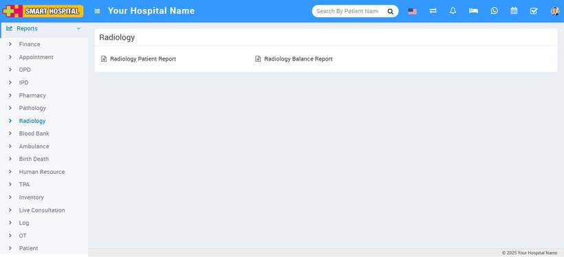
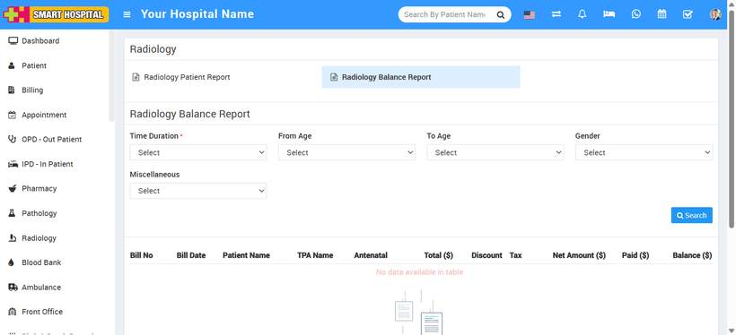
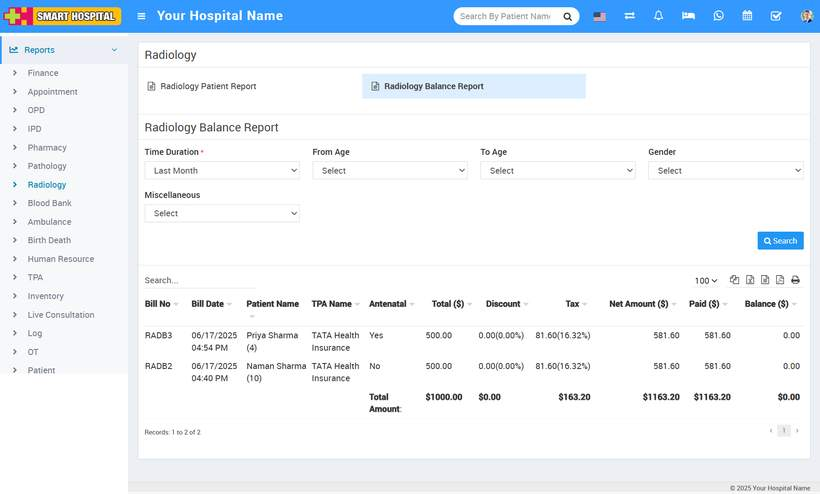

# How to check Radiology Balance Report?

_Sat, 16 Aug, 2025_ · [Reports (44)](https://smart-hospital.in/category/reports) · vendor article: https://smart-hospital.in/article/how-to-check-radiology-balance-report

### How to check Radiology Balance Report?

Sat, 16 Aug, 2025

[Articles](https://smart-hospital.in/articles)[Reports](https://smart-hospital.in/category/reports)

---

To check Radiology Balance report, go to **Reports >** **Radiology Balance** **Report**.   
  
  
  
  
Here select the **Time Duration, From Age, To Age, Gender** **and** **Miscellaneous** then click on**Search** button.  
  
  
  
  
  
Here you can see patient Radiology details like **Bill No, Bill Date, Patient Name, Antenatal, Total, Discount, Tax, Net Amount, Paid, Balance** etc. Also you can download this report as PDF.  
  

