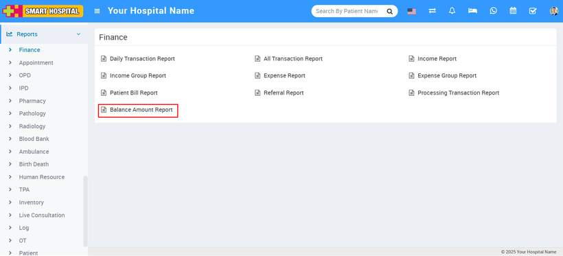
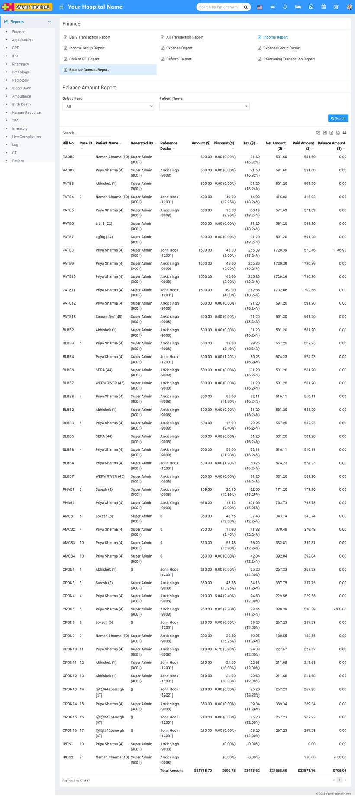

# How to checkBalance Amount Report?

_Sat, 16 Aug, 2025_ · [Reports (44)](https://smart-hospital.in/category/reports) · vendor article: https://smart-hospital.in/article/how-to-checkbalance-amount-report

### How to checkBalance Amount Report?

Sat, 16 Aug, 2025

[Articles](https://smart-hospital.in/articles)[Reports](https://smart-hospital.in/category/reports)

---

To check Radiology Patient report, go to **Reports > Balance Amount Report.  
  
**  
  
Here select the **Select Head** and **Patient Name** then click on**Search** button.Here you can see patient radiology details like **Bill No, Case ID, Patient Name, Generated By, Reference Doctor, Amount, Discount, Tax, Net Amount, Paid Amount, Balance Amount** **etc**. Also you can download this report as PDF.  
  

