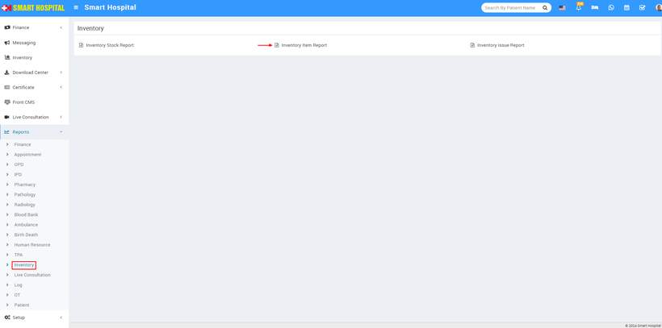
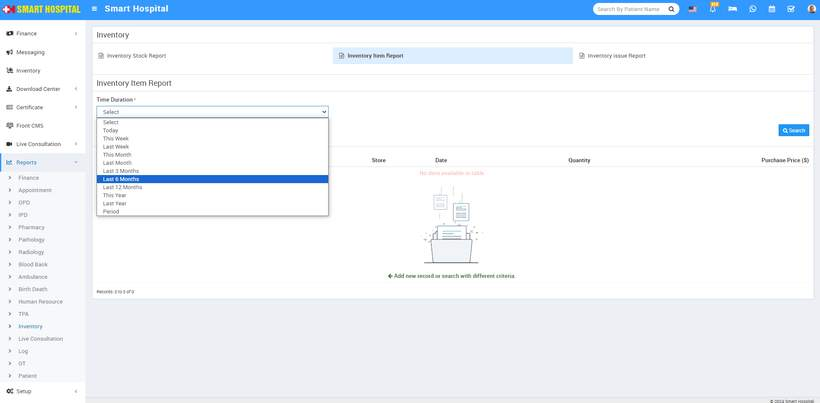
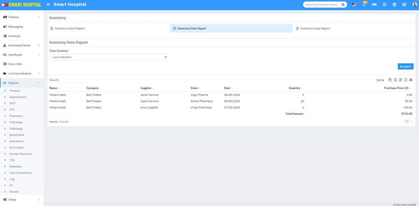

# Inventory Item report

_Fri, 24 May, 2024_ · [Reports (44)](https://smart-hospital.in/category/reports) · vendor article: https://smart-hospital.in/article/inventory-item-report

### Inventory Item report

Fri, 24 May, 2024

[Articles](https://smart-hospital.in/articles)[Reports](https://smart-hospital.in/category/reports)

---

To check Inventory Item report, go to **Reports > Inventory > Inventory Item Report**.  
  
  
  
Now click on Inventory Item Report, below **Time Duration** drop down will appear  
  
  
  
Here select the **Time Duration** then click on**Search** button and you can see **Inventory Item** details like **Name, Category, Supplier, Store, Quantity, Purchase Price, Date** etc. Also you can download this report as PDF.  
  

