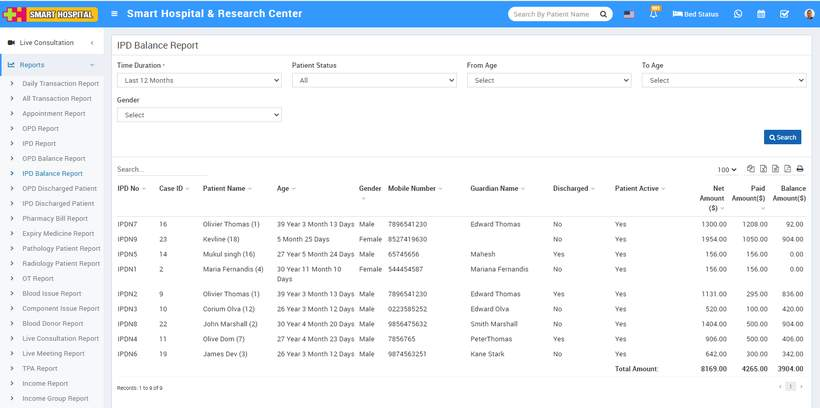

# IPD Balance Report

_Sat, 30 Oct, 2021_ · [Reports (44)](https://smart-hospital.in/category/reports) · vendor article: https://smart-hospital.in/article/ipd-balance-report

### IPD Balance Report

Sat, 30 Oct, 2021

[Articles](https://smart-hospital.in/articles)[Reports](https://smart-hospital.in/category/reports)

---

To check patient IPD Balance report, go to **Reports > IPD Balance Report**. Here select the **Time Duration, Patient Status, From Age, To Age, Gender** then click on**Search** button. Here you can see patient’s IPD Balance Amount details like IPD No, Case ID, Patient Name, Age, Gender, Mobile Number, Guardian Name, Discharged, Patient Active, Net Amount, Paid Amount, and Balance Amount etc.   
  

