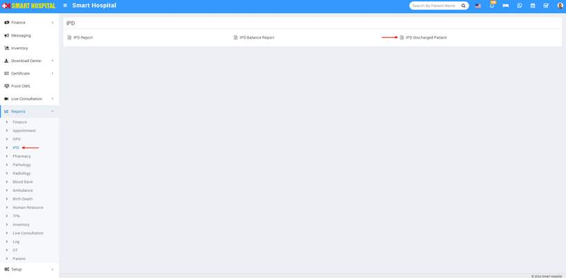
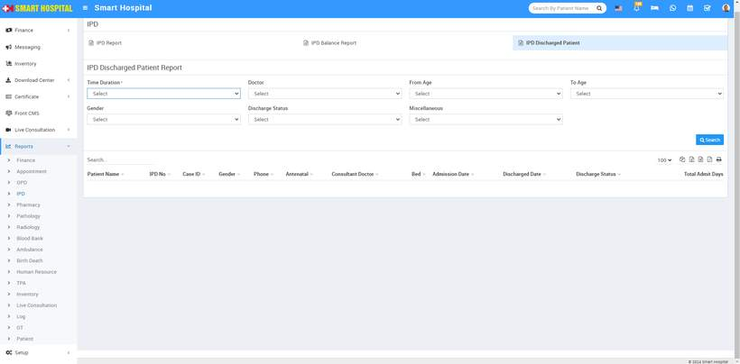

# IPD Discharge Patient Report

_Thu, 23 May, 2024_ · [Reports (44)](https://smart-hospital.in/category/reports) · vendor article: https://smart-hospital.in/article/ipd-discharge-patient-report

### IPD Discharge Patient Report

Thu, 23 May, 2024

[Articles](https://smart-hospital.in/articles)[Reports](https://smart-hospital.in/category/reports)

---

To check IPD Discharged Patient Report, go to **Reports > IPD> IPD Discharged Patient**  
  
  
  
  
Here select the **Time Duration, Doctor, From Age, To Age, Gender, Discharge Status** then click on**Search** button. Here you can see IPD Discharge Patient details like **Patient Name, IPD No, Case ID, Gendar, Phone, Consultant, Bed, Admission Date, Discharge Date, Discharge Status, Total Admit Days** etc. Also you can download this report as PDF.  
  
  

