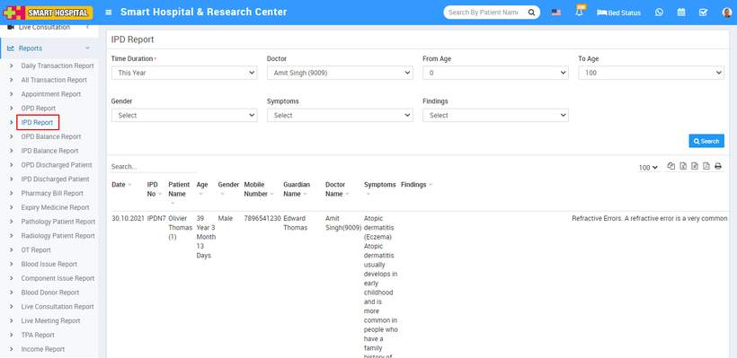

# IPD Report

_Sat, 30 Oct, 2021_ · [Reports (44)](https://smart-hospital.in/category/reports) · vendor article: https://smart-hospital.in/article/ipd-report

### IPD Report

Sat, 30 Oct, 2021

[Articles](https://smart-hospital.in/articles)[Reports](https://smart-hospital.in/category/reports)

---

To check patient IPD report, go to **Reports > IPD Report**. Here select the **Time Duration, Doctor, From Age, To Age, Gender,** **Symptoms**  and **Findings** then click on**Search** button. Here you can see patient IPD details like **IPD No, Patient Name, Age, Gender, Mobile Number, Guardian Name, Doctor Name, Symptoms, Findings** etc.  
  

