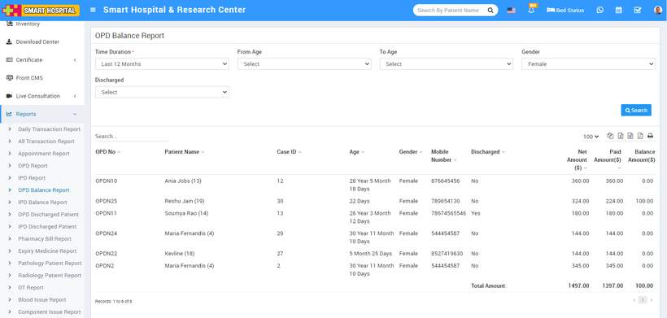

# OPD Balance Report

_Sat, 30 Oct, 2021_ · [Reports (44)](https://smart-hospital.in/category/reports) · vendor article: https://smart-hospital.in/article/opd-balance-report

### OPD Balance Report

Sat, 30 Oct, 2021

[Articles](https://smart-hospital.in/articles)[Reports](https://smart-hospital.in/category/reports)

---

To check patient OPD Balance report, go to **Reports > OPD Balance Report**. Here select the **Time Duration, From Age, To Age, Gender and** **Discharged** then click on**Search** button. Here you can see patient’s OPD Balance details like OPD No, Patient Name, Case ID, Age, Gender, Discharged Net Amount, Paid mount, Balance Amount etc.   
  

