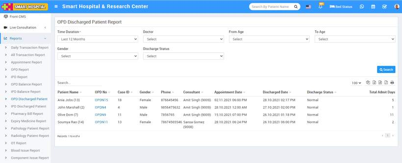

# OPD Discharge Patient Report

_Sat, 30 Oct, 2021_ · [Reports (44)](https://smart-hospital.in/category/reports) · vendor article: https://smart-hospital.in/article/opd-discharge-patient-report

### OPD Discharge Patient Report

Sat, 30 Oct, 2021

[Articles](https://smart-hospital.in/articles)[Reports](https://smart-hospital.in/category/reports)

---

To check OPD Discharge Patient Report, go to **Reports > OPD Discharge Patient Report**. Here select the **Time Duration, Doctor, From Age, To Age, Gender, Discharge Status** then click on**Search** button. Here you can see OPD Discharge Patient details like **Patient Name, OPD No, Case ID, Gendar, Phone, Consultant, Appointment Date, Discharge Date, Discharge Status, Total Admit Days etc**. Also you can download this report as PDF.  
  

