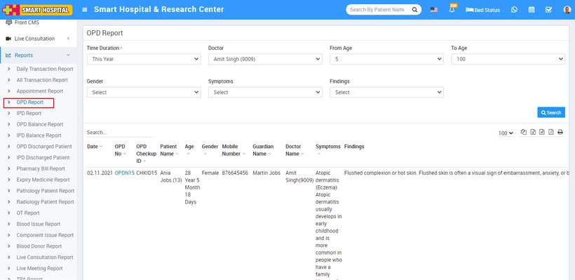

# OPD Report

_Sat, 30 Oct, 2021_ · [Reports (44)](https://smart-hospital.in/category/reports) · vendor article: https://smart-hospital.in/article/opd-report

### OPD Report

Sat, 30 Oct, 2021

[Articles](https://smart-hospital.in/articles)[Reports](https://smart-hospital.in/category/reports)

---

To check patient OPD report, go to **Reports > OPD Report**. Here select the **Time Duration, Doctor, From Age, To Age, Gender,** **Symptoms**  and **Findings** then click on**Search** button. Here you can see patient OPD details like **OPD No, Checkup ID, Patient Name, Doctor Name, Symptoms, Findings** etc.  
  

