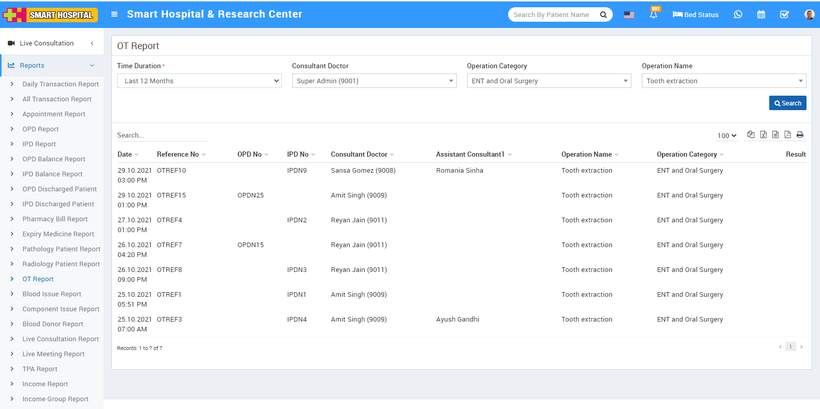

# OT Report

_Sat, 30 Oct, 2021_ · [Reports (44)](https://smart-hospital.in/category/reports) · vendor article: https://smart-hospital.in/article/ot-report

### OT Report

Sat, 30 Oct, 2021

[Articles](https://smart-hospital.in/articles)[Reports](https://smart-hospital.in/category/reports)

---

To check User Log report, go to **Reports > OT Report**. Here select the **Time Duration** **Consultant Doctor, Operation Category and Operation Name** then click on**Search** button. Here you can see Patient OT details like Date, Reference No, **OPD No, IPD No, Consultant Number,Operation Name, Operation Category, Result** etc. Also you can download this report as PDF.  
  

