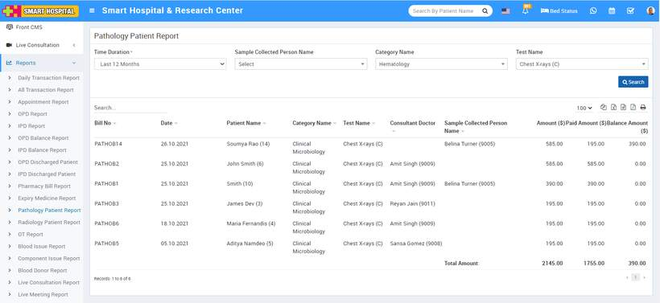

# Pathology Patient Report

_Sat, 30 Oct, 2021_ · [Reports (44)](https://smart-hospital.in/category/reports) · vendor article: https://smart-hospital.in/article/pathology-patient-report

### Pathology Patient Report

Sat, 30 Oct, 2021

[Articles](https://smart-hospital.in/articles)[Reports](https://smart-hospital.in/category/reports)

---

To check Pathology Patient report, go to **Reports >** **Pathology Patient** **Report**. Here select the **Time Duration, Sample Collected Person Name, Category Name** **and** **Test Name** then click on**Search** button. Here you can see patient pathology details like **Bill No, Patient Name, Test Name, Consultant Doctor, Sample Collected Person Name, Amount, Paid Amount, Balance Amount** etc. Also you can download this report as PDF.  
  

