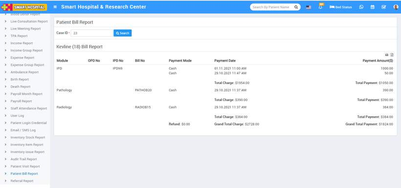

# Patient Bill Report

_Sat, 30 Oct, 2021_ · [Reports (44)](https://smart-hospital.in/category/reports) · vendor article: https://smart-hospital.in/article/patient-bill-report

### Patient Bill Report

Sat, 30 Oct, 2021

[Articles](https://smart-hospital.in/articles)[Reports](https://smart-hospital.in/category/reports)

---

To check Patient Bill Report, go to **Reports > Patient Bill Report**. Here enter the Case ID (you will get Case ID from OPD or IPD) then click on**Search** button. Here you can see **Patient Bill** details like **Patient Name, Module, OPD No, IPD No, Bill No, Payment Mode, Payment Date, Payment Amount** etc. Also you can download this report as PDF.  
  

