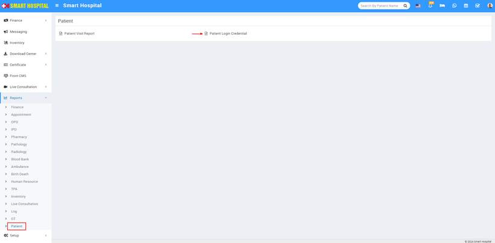
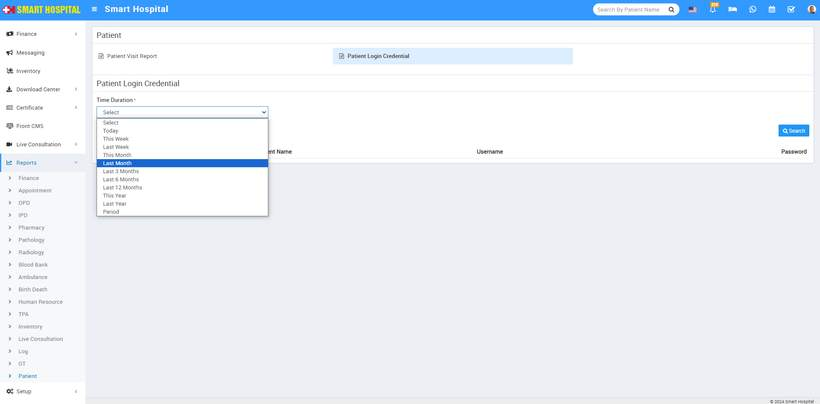
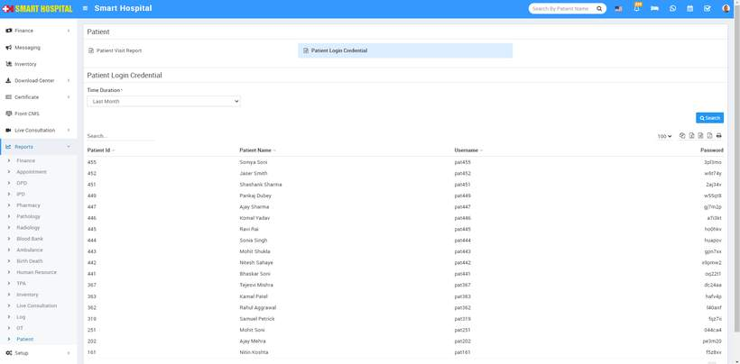

# Patient Login Credential Report

_Fri, 24 May, 2024_ · [Reports (44)](https://smart-hospital.in/category/reports) · vendor article: https://smart-hospital.in/article/patient-login-credential-report

### Patient Login Credential Report

Fri, 24 May, 2024

[Articles](https://smart-hospital.in/articles)[Reports](https://smart-hospital.in/category/reports)

---

To check Patient Login Credential report, go to **Reports > Patient,** here you will see two report available Patient Visit Report and **Patient Login Credential** ****Now click on **Patient Login Credential**, in below Time Duration drop down will be open, using this drop down you can search and get the details of that time duration ****  
here we select the **Last Month** and then click on **Search**, the details will be appear in below.  
  
  
  
**Patient Login Credential,** Here you can see Patient Login Credential details like **Patient Id, Patient Name, Username and Password** etc. Also you can download this report as PDF.
