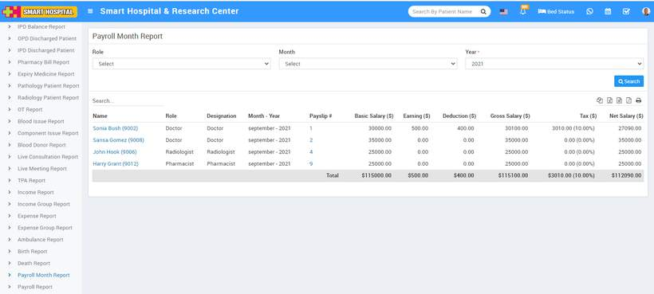

# Payroll Month Report

_Sat, 30 Oct, 2021_ · [Reports (44)](https://smart-hospital.in/category/reports) · vendor article: https://smart-hospital.in/article/payroll-month-report

### Payroll Month Report

Sat, 30 Oct, 2021

[Articles](https://smart-hospital.in/articles)[Reports](https://smart-hospital.in/category/reports)

---

To check Payroll Month report, go to **Reports >** **Payroll Month** **Report**. Here select the **Role, Month and Year** then click on**Search** button. Here you can see Death details like **Name, Role, Designation, Month –Year, Payslip, Basic Salary, Earning, Deduction, Gross Salary, Tax, Net Salary** etc. Also you can download this report as PDF.  
  

