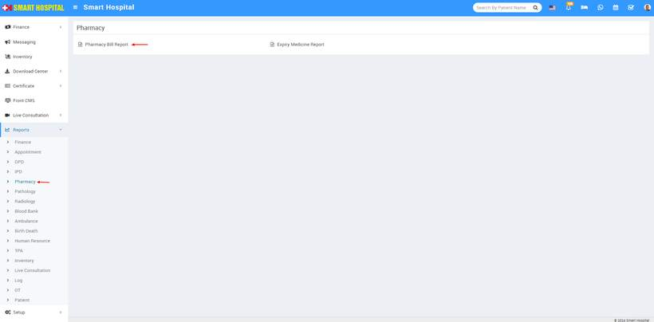
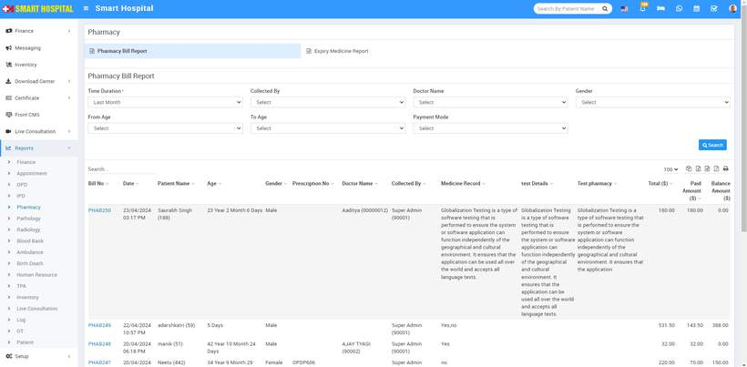

# Pharmacy Bill Report

_Thu, 23 May, 2024_ · [Reports (44)](https://smart-hospital.in/category/reports) · vendor article: https://smart-hospital.in/article/pharmacy-bill-report

### Pharmacy Bill Report

Thu, 23 May, 2024

[Articles](https://smart-hospital.in/articles)[Reports](https://smart-hospital.in/category/reports)

---

To check Pharmacy Bill report, go to **Reports > Pharmacy >** **Pharmacy Bill** **Report  
  
**  
  
Here select the **Time Duration, Collected By, From Age, To Age, Gender** and **Payment Mode** then click on**Search** button. Here you can see patient **Pharmacy Bill** details like Bill No, Patient Name, Age, Gender, Prescription No, Doctor Name, Collected By, Total Paid Amount etc.  
  

