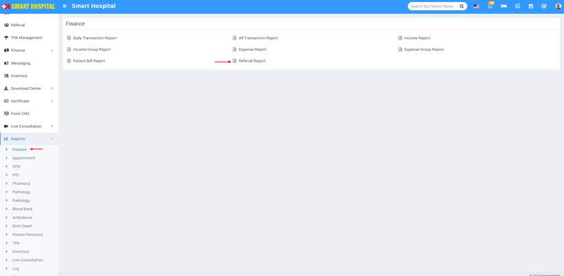
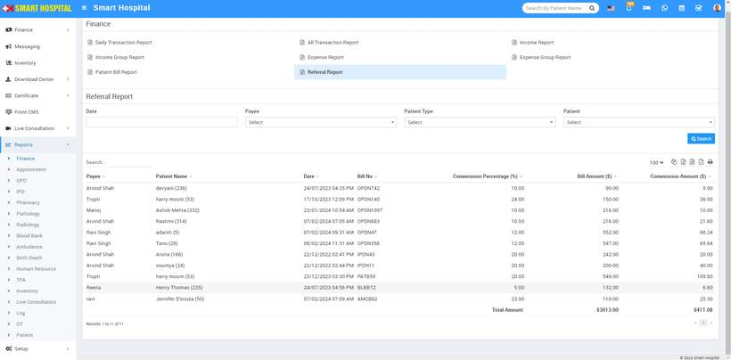

# Referral Report

_Thu, 23 May, 2024_ · [Reports (44)](https://smart-hospital.in/category/reports) · vendor article: https://smart-hospital.in/article/referral-report

### Referral Report

Thu, 23 May, 2024

[Articles](https://smart-hospital.in/articles)[Reports](https://smart-hospital.in/category/reports)

---

To check Referral Report, go to **Reports > Finance >** **Referral Report**.  
  
  
  
Here search for **Date**, **Payee**, **Patient Type** and **Patient** **(optional)** then click on**Search** button. Here you can see **Referral** details like **Name, Patient Name, Date with Time, Bill No, Bill Amount, Commission Percentage, Commission Amount** etc. Also you can download this report as PDF.  
  

