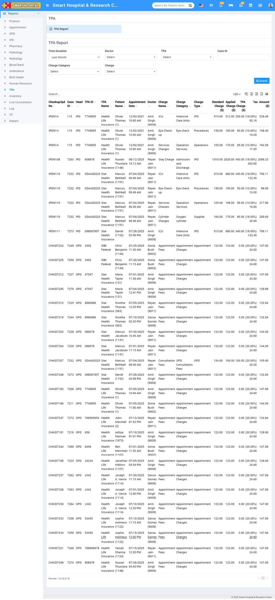

# TPA Report

_Fri, 01 Aug, 2025_ · [Reports (44)](https://smart-hospital.in/category/reports) · vendor article: https://smart-hospital.in/article/tpa-report

### TPA Report

Fri, 01 Aug, 2025

[Articles](https://smart-hospital.in/articles)[Reports](https://smart-hospital.in/category/reports)

---

To check TPA report, go to **Reports >** **TPA** **Report**. Here select the **Time Duration, Doctor, TPA, Case ID, Charge Category and Charge** then click on**Search** button. Here you can see TPA details like **Checkup/IPD No, Case ID, Head, TPA ID, TPA Name, Patient Name, Appointment Date, Doctor, Charge Name, Charge Category, Charge Type, Standard Charge, Applied Charge, TPA Charge, Tax Amount** etc. Also you can download this report as PDF.  
  

