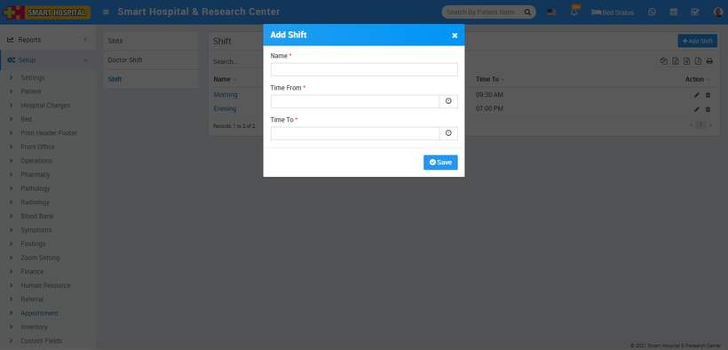
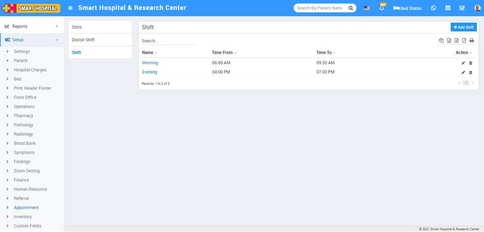
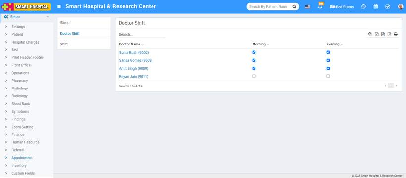
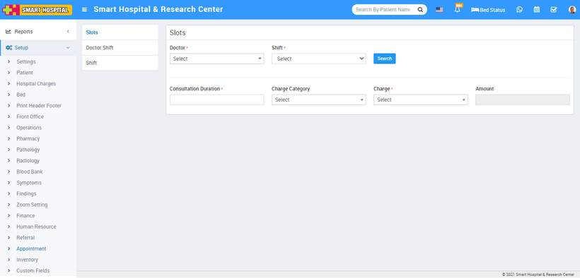

# Appointment

_Sun, 31 Oct, 2021_ · [Setup & Configuration (22)](https://smart-hospital.in/category/setup-configuration) · vendor article: https://smart-hospital.in/article/appointment

### Appointment

Sun, 31 Oct, 2021

[Articles](https://smart-hospital.in/articles)[Setup & Configuration](https://smart-hospital.in/category/setup-configuration)

---

To setup Appointment go to **Setup > Appointment**. Here first we should create **Shift** then **Doctor Shift** and then will create **Slots** for appointment.  
  

### **Shift**

To add Shift click on **+ Add Shift** button now enter **Name, Time From, Time To** and then click on **Save** button.  
  
  
  
You can check added Shift record at **Shift List** page.  
  

To edit Shift click on edit and to delete Shift click on delete icon present at **Action** column.  
  

---

### **Doctor Shift**

All doctors will show here at doctors shift, here by check on check box you can allot shift to doctors.  
  
  
  

---

### **Slots**

To add slot you should first select doctor from Doctor drop down then select shift and then click on search button. After click on search button you will get the option to allot slot for appointment for selected doctor.

Now select **Consultation Duration, Charge Category, Charge** and **Amount** and then enter **Time From and Time To** as per selected Day of week for doctor appointment then click on **Save** button.  
  

