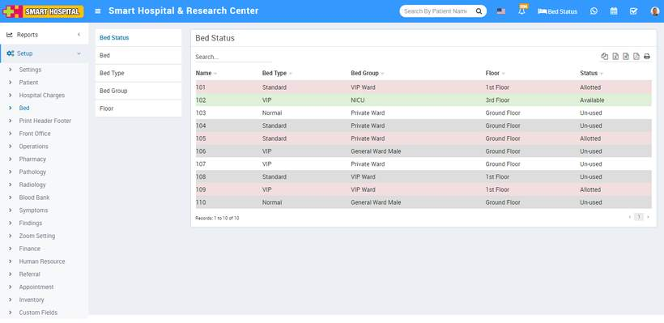
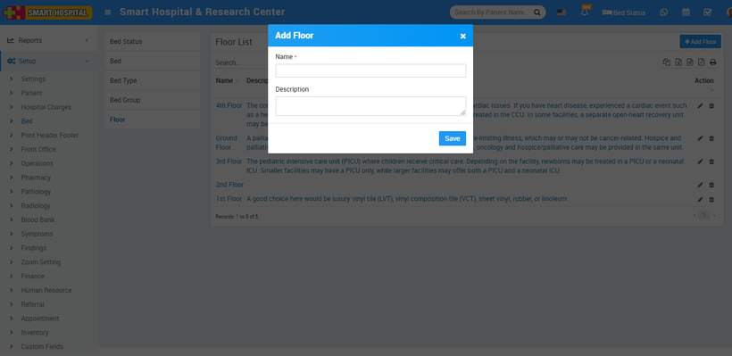
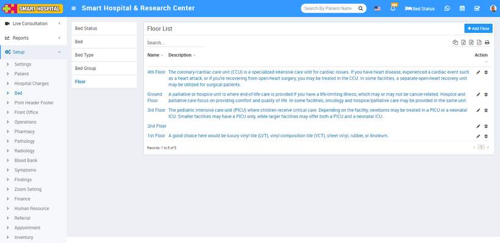
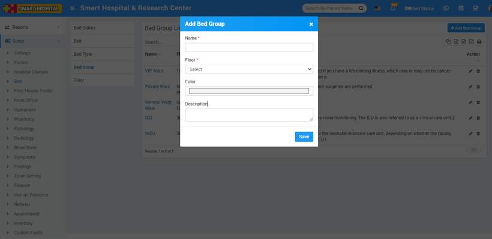
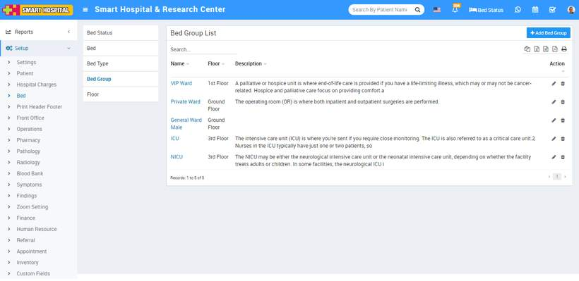
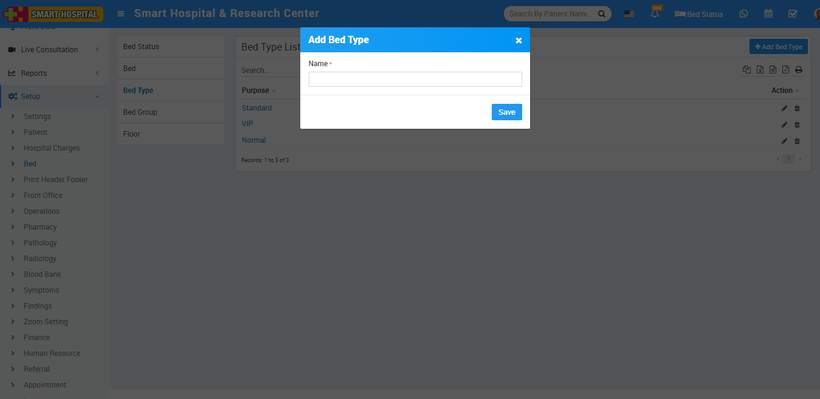
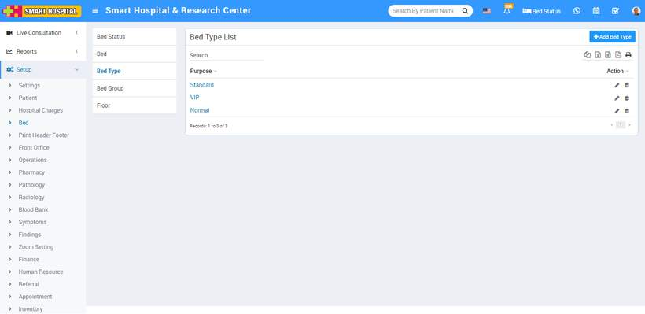
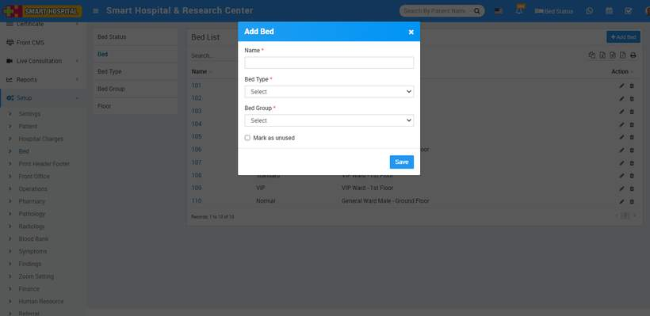
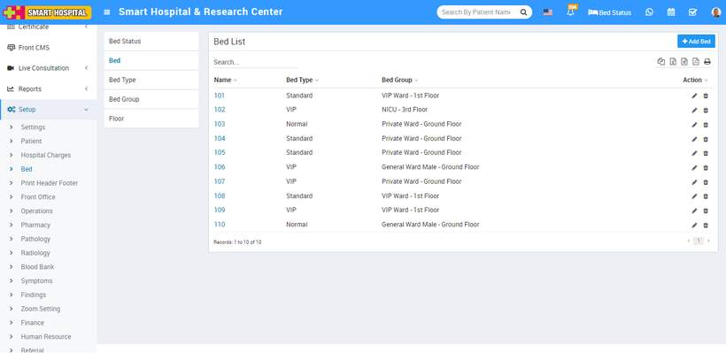

# Bed

_Sun, 31 Oct, 2021_ · [Setup & Configuration (22)](https://smart-hospital.in/category/setup-configuration) · vendor article: https://smart-hospital.in/article/bed

### Bed

Sun, 31 Oct, 2021

[Articles](https://smart-hospital.in/articles)[Setup & Configuration](https://smart-hospital.in/category/setup-configuration)

---

### **Bed Status**

Bed status define admit patients details as in which floor, room and bed patient is admitted.

To assign bed to a patient in Smart Hospital first you should have to do setup for bed. Here first you should add **Floor** of the Hospital building, **Bed Group** then **Bed Type** and at last you can create **Bed** record.

All bed record allotted and available lists will show here at **Bed Status** List.

There is also quick search is available to check allotted and available bed status at top of the header at right site. By click on **Bed** status button you can check allotted and available bed status list.  
  

You can also check patient details of allotted bed at mouse hover of bed icon or by click on bed icon, this will open IPD details of that patient.

You can also admit patient directly from Bed Status for available bed. For this is just click on available bed icon and add patient in IPD.

---

### **Floor**

To add bed you need to first add Floor. To add Floor go to **Setup > Bed > Floor**, click on **+ Add Floor** button and Name and Description for floor and click on **Save** button.  
  
  
  
You can check this added record at Floor list page.  
  

To edit Floor click on **Edit** icon and to delete section click on **Delete** icon present in the Floor  list.

---

### **Bed Group**

You can add Bed Group to differentiate different ward on the same floor. To add Bed Group go to **Setup > Bed > Bed Group**click on Add Bed Group button, here enter Name, Floor, Color and Description for the Bed Group and click on **Save** button.  
  
  
  
  
You can check this added record at Bed Group list page.  
  

To edit Bed Group click on **Edit** icon and to delete section click on **Delete** icon present in the Bed **Group list**.

---

### **Bed Type**

To add Bed Type go to **Setup > Bed > Bed Type** click on Add Bed Type button enter Name and click on **Save** button.  
  
  
  
  
You can check this added record at Bed Type list page.  
  

To edit Bed Type click on **Edit** icon and to delete section click on **Delete** icon present in the **Bed Type**  list.

---

### **Bed**

To add bed go to **Setup > Bed > Bed** click on Add Bed button, here enter **Name, Bed Type, Bed Group** and **Marked as unused (optional)** and click on **Save** button.  
  
  
  
You can check this added record at Bed list page.  
  

To edit Bed click on **Edit** icon and to delete section click on **Delete** icon present in the Bed list.
