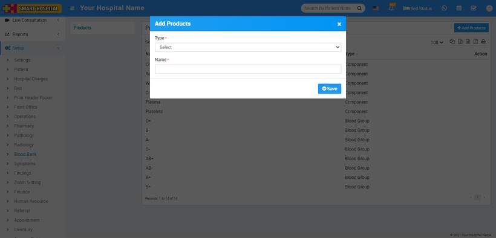
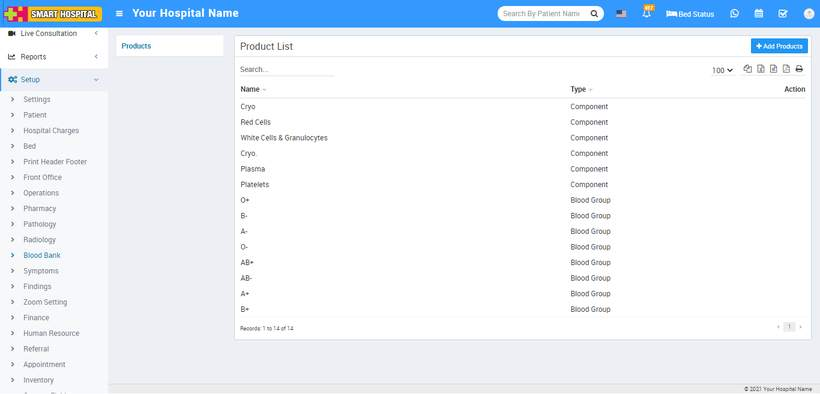
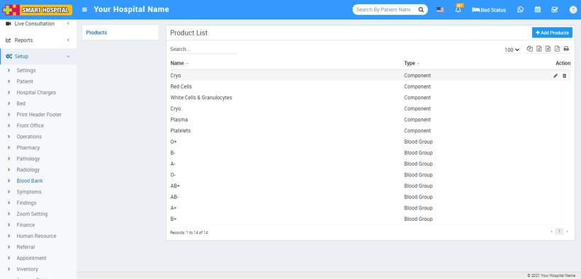

# Blood Bank

_Wed, 27 Oct, 2021_ · [Setup & Configuration (22)](https://smart-hospital.in/category/setup-configuration) · vendor article: https://smart-hospital.in/article/blood-bank

### Blood Bank

Wed, 27 Oct, 2021

[Articles](https://smart-hospital.in/articles)[Setup & Configuration](https://smart-hospital.in/category/setup-configuration)

---

To setup Blood Bank go to **Setup > Blood Bank**.

To add Product for Blood Group click on **+ Add Product** button now enter **Product Type** as **Blood Group or Component**, enter Name and click on **Save** button.  
  

You can check added Product record at **Product List** page.  
  

To edit Product click on edit and to delete Product click on delete icon present at **Action** column.  
  

