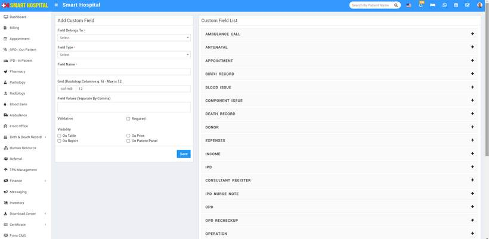

# Custom Field

_Thu, 23 May, 2024_ · [Setup & Configuration (22)](https://smart-hospital.in/category/setup-configuration) · vendor article: https://smart-hospital.in/article/custom-field

### Custom Field

Thu, 23 May, 2024

[Articles](https://smart-hospital.in/articles)[Setup & Configuration](https://smart-hospital.in/category/setup-configuration)

---

To add custom field in Smart Hospital different modules, go to **Setup > Custom Field. Here at right side you will get Custom Field List of those modules for which you can add custom fields, here** select **Field Belongs To, Field Type, Field Name, Grid** **(Bootstrap Column e.g. 6) - Max is 12, Field Values (Separate By Comma)** and check **Validation and Visibility** as per your choice and then click on **Save** button

You can view this added record in the **Custom Field List** on the right side of the page by click on +icon for respected module.  
  

To edit custom field click on **Edit** icon and to delete custom field click on **Delete** icon present in the custom field list.
